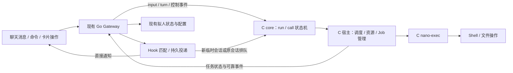

# Agent 执行能力与拟人配置扩展设计

日期：2026-10-26；2026-10-27 补充用户插话与会话 Fork 设计；2026-10-28 补充拟人 agent 内心活动与外界会话共用一份经历的重设计（第 14 节）。状态：调研完成，待实施；本文不表示功能已经上线。

首次调研的代码基线：`1bf7e9e`，以 2026-10-26 阅读到的工作区代码为准。已有设计文档只用于理解背景，以下“当前实现”均核对了当时代码；新增插话、Fork 部分另外核对了 2026-10-27 的 Gateway 消息入口、模型循环和会话存储。目标是补齐并行工具、用户插话、会话 Fork、后台 Shell、可关闭的沙箱、事件 Hook，以及拟人 agent 的每日唤醒与心智配置。**保留 C 内核和 C 执行器，继续复用现有 Go Gateway，不新增常驻 Python、Node、JVM 或容器服务。**

## 1. 代码审查结论

| 位置 | 当前真实行为 | 设计影响 |
| --- | --- | --- |
| `kernel/src/core.c:on_turn / maybe_advance` | 遍历本轮全部调用，分别发出 EXEC；全部得到结果才请求下一轮模型 | 并行派发已经存在，需要补齐限额、排队和资源冲突，而非重写 agent 循环 |
| `kernel/tests/test_core.c:test_parallel_calls_wait_for_all` | 已测试两个调用同时派发、结果乱序、等待全部完成 | 保留这一不变量，并扩充后台移交的结果语义 |
| `kernel/src/runner.c`、`main.c:loop` | POSIX 用非阻塞管道、进程组和 poll 管理多个执行器 | 可以沿用事件循环；不需要每个调用起一个内核线程 |
| `kernel/src/runner_win.c:runner_start_ex` | Windows 每个执行器有两个读取线程，请求仍同步写入 stdin | C 实现不自动等于低内存；Windows 的线程和大请求写入要单独改造 |
| `gateway/internal/app/exec.go`、`mcp.go` | 远程执行、MCP 等通过 goroutine 在锁外运行；部分内置状态操作在 App 总锁内完成 | 不应简单给整个 execTool 再包一层并发；需区分短状态提交与耗时 I/O |
| `gateway/internal/app/mcp_desktop.go` | 已有桌面调用门闩和跨观察、操作、验证的 run 级租约 | 并行功能必须复用这套独占规则 |
| `kernel/src/nexec_proc.c:tool_shell`、`nexec.h`、`tools.c` | Shell 默认 120 秒，最大 600 秒；C core 的兜底是 610 秒；执行器只在结束时返回一次 JSON | 没有受管理的后台任务或实时输出协议；只加 background 参数不足以完成需求 |
| `kernel/src/main.c:disconnect`、`core.c:on_reset`、`app.go:endRun` | 断线、run 收尾会清理执行状态；网关取消 run 所属执行上下文 | 后台任务的所有权必须从 run 分离 |
| `kernel/src/nexec_main.c:main / enter_sandbox` | 成功 setup 后总是调用 enter_sandbox；Linux 下施加现有 Landlock / seccomp / no_new_privs | 当前没有主动关闭沙箱的配置；`full` 也不会关闭沙箱 |
| `kernel/src/core.c:decide`、`app/approvals.go` | auto 在没有沙箱时对 Shell 要审批；full 是网关自动批准请求 | “审批策略”和“执行隔离”目前耦合，需要拆开表达 |
| `kernel/src/sandbox_win.c`、`sandbox_stub.c` | Windows / macOS 目前没有 OS 沙箱；文件工具仍做应用层路径检查 | UI 必须区分可用能力、请求模式、实际生效状态 |
| `gateway/internal/events/events.go` | 网页 SSE 总线订阅者积压时直接丢弃事件，没有持久化 | 可继续显示状态，不能作为可靠提醒的唯一触发源 |
| `gateway/internal/app/autonomy.go`、`autonomy/state.go` | 已有事件、目标、日程、执行证据、反思和恢复；当前由 15 秒扫描检查到期事项 | Hook 应接入既有执行链，不能再造一套 Go agent 内核 |
| `gateway/internal/app/life.go:lifeLevels` | low / normal / high 绑定 4 / 8 / 16 次每日探索唤醒，以及 1 / 2 / 4 次主动联系额度 | 活跃间隔、唤醒次数、主动联系次数需要独立配置 |
| `autonomy/state.go:Trigger.CanStart` | MaxWakes 大于 0 才限制次数；但调用方一直传固定档位值 | 底层已有“不限”判断，主要缺配置、统一解析和显示 |
| `autonomy/state.go:Self / Belief / Idea / Intention` | 已有兴趣、置信度、兴趣分、新颖分、优先级和进度；没有能量、心情等通用数值系统 | 先开放已有数值，再提供可选的行为维度，避免把不存在的模型当成现状 |
| `channel/channel.go:RunView` | Tool / ToolResult 接口没有 call ID，展示依赖调用顺序 | 真正并行后工具卡片可能配错，必须同时改展示接口 |
| `app/identity.go`、`session/store.go` | 内部会话身份固定；历史在磁盘和内存各存一份，没有临时会话专用回收机制 | Hook 临时对话必须显式分类、固定 agent 并回收缓存 |
| `app.go:OnMessage / startRun / generateModel`（2026-10-27 补查） | 普通新消息进入 s.queue；有 run 时不启动新 run，也不在工具轮之间消费队列；生成完成后直接记 assistant、发送 turn | 需要独立的当前 run 插话入口，以及工具批次和模型生成完成后的消费边界 |
| `endpoints.go:newSessionIn / cmdSession`、`session/settings.go`（2026-10-27 Fork 补查） | 可以建空会话、把窗口改接到另一会话；没有分叉点、上下文快照或父子关系 | Fork 需要独立的持久上下文与执行入口，不能直接复用“新建并切换” |
| `rooms.go:messageChat`、`approvals.go:approvalOuts`（2026-10-27 Fork 补查） | Message 可投递私聊；life 审批会回落到主会话；界面概览会加载各会话上下文 | 安静分支必须覆盖主动消息和审批路由，并避免概览将所有分支历史加载进内存 |
| `app/autonomy.go:mindHeard`、`autonomy/plan.go:BriefForModel`（2026-10-28 补查） | 每条聊天消息的原话记成事件和“认识”，并把自主检查提前到 10 分钟后；聊天里的处理结果、`/reset` 等生命周期变化不进入心智状态 | 内心醒来只看到请求、看不到结局，会把聊天里已处理的事当成待办；详见第 14 节 |
| `compact.go:compactLimits`、`life.go:lifeRecentNote`、`life.go:lifeHeard`（2026-10-28 补查） | `@<id>/life` 是一条一直追加、到 40k 才压缩的连续会话；聊天侧只看到不分可见范围的三行近况；做梦结果只写进内心会话 | 同一 agent 有两份互不相通的上下文，两边事实对不上；需要统一的经历记录和按片段运行的内心活动（第 14 节） |

2026-10-26 的基线验证：当时 C core 测试 **154 checks，0 failures**；`go test ./internal/autonomy` 通过。没有执行需要真实模型、聊天平台或用户凭据的测试；这不是后续工作区代码的重新验收记录。

## 2. 总体结构与边界



- **C core** 继续只处理事件和输出命令，控制 run、调用结果屏障、取消、审批及前置 Hook 屏障；不访问文件、不调模型、不读真实时钟。
- **C 宿主 / 执行节点** 管理真实子进程、机器资源限额、输出、后台任务和文件观察。磁盘与平台 I/O 留在这一层。
- **Go Gateway** 继续负责模型 API、渠道、用户配置、跨机器路由、可靠事件与 Hook 投递，以及已有拟人状态；新临时对话仍交给 C core 执行。
- **Hook 脚本** 是按事件短暂启动的用户程序。默认可以使用系统 Shell；用户已有 Python 等解释器时可自行选择，不作为安装依赖。

统一分清三个生命周期：`Conversation → Run → ToolCall`，另有独立的 `Job`。ToolCall 可以完成“移交给 Job”，不代表 Job 的命令执行成功。并行不会让同一会话同时有两个模型轮次写历史；当前任务期间收到的用户补充进入有序插话收件箱，在本轮工具调用或本次模型生成结束后注入当前 run，其他消息仍按会话排队。

Fork 创建的是有独立历史后续部分的持久 Conversation：继承某个已闭合边界的上下文，随后用新的 sid / run_id 继续走 C core。它不复制一个内核进程，也不复制一个新的拟人人格；原会话、分支会话和独立 Job 分别管理生命周期。

### 2.1 身份和结果不变量

引入明确的 `run_id`、`turn_id`、`call_id` 和 `node_epoch`，不能继续只依靠 sid 和模型生成的调用 ID 关联异步结果。完整调用身份为 `(sid, run_id, turn_id, call_id)`；Job 另有稳定 `job_id`。

1. 每个已接受调用恰好产生一个协议终态结果：成功、失败、取消、拒绝、超时或“已移交后台”。
2. 当前轮的全部调用取得终态结果后才请求下一轮模型。异步工具事件不能插进未闭合的 tool_calls 序列。
3. Job 的终态通过独立事件投递，不再用原 call_id 补第二条工具结果。
4. 迟到、重复、跨 run 的消息不改变当前 run；不能用重试掩盖执行结果未知。
5. 有限资源和待处理容量是明确的运行参数；达到上限应返回可读错误，不能无限分配直到内存耗尽。

Gateway 在把 assistant 的 tool_calls 写入历史前，先检查调用数量、空 ID、重复 ID 和参数总大小；结构无效时整轮按模型协议错误处理，不执行其中一部分再报错。C 宿主和 core 对线上的同类错误也做防御性检查。重复 ID 无法可靠配对结果，不能通过给同一个 ID 回两次结果来“修复”。

## 3. 并行工具：在已有派发上补完整调度

### 3.1 调用状态与限额

```text
validated → [wait_hook] → [wait_approval] → queued → running → done
                       拒绝 / 取消 / 超时 ─────────────────→ done
```

审批不占执行槽；queued 也不占执行槽。单次执行超时从实际启动开始计时；审批超时、排队超时、run 总时限分别计时。对既有 `CALL_WAIT_APPROVAL / CALL_RUNNING / CALL_DONE` 增加排队状态及可选 Hook 等待状态。

建议首版默认值（可配置，实施时压测确认）：

| 参数 | 默认 | 含义 |
| --- | --- | --- |
| max_calls_per_turn | 32 | 限制单次模型批量调用，防止参数和状态无限展开 |
| max_active_runs_per_node | 16 | C core 中同时活跃的 run 上限；超出留在有界 Gateway 队列 |
| max_parallel_tools_per_run | 4 | 同一 run 正在运行的工具数 |
| max_active_execs_per_machine | 8 | 同一机器真实执行器数，含后台 Shell 和 Hook 脚本 |
| max_parallel_shells_per_machine | 2 | Shell 数量上限；还须满足资源锁 |
| max_background_jobs_per_agent | 4 | 一个 agent 正在执行的后台任务数 |
| max_live_jobs_per_machine | 16 | 前台、后台、待启动 Job 的总数上限 |
| max_queued_calls_per_run | 32 | 等资源的调用上限 |

采用按会话轮转的公平队列；用户操作优先于自主探索，但低优先级需有等待时间加权，不能永远饿死。后台任务占用真实进程槽，转后台只释放当前 ToolCall 的等待关系，不凭空增加可执行进程数。Hook 脚本同样消耗执行槽，另外留一个小的 Hook 分区，避免长 Shell 占满所有提醒处理能力。

C core 管理每个 run 的槽位；C 宿主管理节点真实槽位。跨节点、SSH、MCP 的机器级租约由 Gateway 协调，节点也要保留本机硬上限。派发到网关不等于已经开始执行：明确区分 `accepted / queued / started`；执行时限从 started 算。Gateway 只授予资源租约，不决定模型下一步。

派发后、started 前还要有受限的 dispatch 等待状态，启动失败直接闭合调用；不能在等待节点接单期间就启动执行超时。Gateway 重启后先完成 jobs_sync、恢复后台 Job 持有的资源，再放行同一机器的新写操作；设备失联时将其租约标为状态未知，不当作资源已经释放。

### 3.2 资源冲突策略

**权限分类不能代替并发分类。** 现有 `NA_TOOL_PUBLIC_READ` 包含 Message 等有副作用的操作，不能把这一枚举当成“并发安全”。新增宿主侧 `effect / resource_keys / lock_mode` 元数据，由真实工具和已验证参数解析。

| 工具 | 默认调度方式 |
| --- | --- |
| Read / Grep / WebSearch / WebFetch | 无冲突时并行；文件读取持共享锁，网络操作有独立并发上限 |
| Write / Edit | 规范化目标文件独占；首版可先按工作目录独占，之后再细化 |
| Shell | 默认对涉及的工作目录持独占锁；提权、off 模式或作用域不明时扩大到机器文件资源锁 |
| Knowledge / Agenda / Idea / Mind | 同一知识库或同一 agent 状态的变更串行提交，外部 I/O 在锁外进行 |
| Message / SendFile | 同一投递目标按序，其他目标可并行 |
| MCP | 默认每个服务串行；配置证明独立的工具可放宽；桌面仍按机器和现有 run 级租约独占 |

必须把符号链接、重叠挂载、同机目录别名归入相同资源域；不能只用 workspace 显示名加锁。一般 Shell 无法靠字符串解析证明无副作用，不根据模型自报“只读”放松锁。需要同项目并行构建等能力时，提供用户可配置的资源分组规则；模型可以增加资源声明，不能自行缩小默认范围。明确配置独立输出目录后允许并行。

资源以固定顺序一次申请，拿不到即回队列；不要拿一半等待另一半。命令运行中不能因为转后台释放文件锁，否则用户后续写文件会与后台任务冲突。状态中展示等待的资源和持有者；用户可停止占用者。

同一批里存在真正数据依赖的调用，仍由模型分成两轮；首版不增加依赖 DAG 工具，也不创建一个执行多段任意代码的 Parallel 包装工具。

### 3.3 上下文和平台展示

- 保持工具结果按实际完成顺序追加，使用完整调用身份关联；模型请求只在结果屏障关闭后发出。
- 给渠道增加可选 `ToolEvent{RunID, CallID, Name, State, Detail}` 接口；保留旧 RunView 适配器，但并行展示不得靠“最后一个工具”定位结果。
- 新工具、并发说明和后台语义更新 `context.go:prefixVer` 与权限签名；参数 schema 仅在支持的节点上暴露。
- 当前兼容模型接口已经支持返回 calls 数组。模型仍可能选择一次一个调用；运行时支持并行不保证模型一定生成并行请求。提供稳定提示说明并用确定性模型替身测试调度，不依赖真实模型偶然输出多个调用。

### 3.4 用户插话：等待本轮结束，在下一步之前插入

**2026-10-27 用户确认的语义：当前一轮工具调用必须完整结束；模型正在生成时也必须等这次生成结束。普通新消息不自动取消工具、不取消模型生成。后台 Job 自己运行，不参与前台插话的等待条件。**

默认将当前任务发起人在同一会话中继续发来的普通消息视为插话，进入当前 run 的有序收件箱。无需用户先发停止命令，也不必等整场 agent 工具循环全部结束。明确的 `/stop`、`/bg`、审批等控制命令继续走原有控制入口，不当成普通插话。

这里的“一轮工具调用”指已经交给 C core 的一个完整 calls 批次，包括该批次正在运行、排队或等待审批的调用。即使其中一个并行调用提前完成，也不能先插入用户消息、先调用模型。**所有调用都有最终结果后，先处理插话，再决定下一步。** 插话到达不会冻结该批次中尚未执行的调用；用户需要马上停止时，仍使用明确的停止操作。

#### 边界规则

| 新消息到达时的前台状态 | 当前工作如何处理 | 何时插入 |
| --- | --- | --- |
| 一批工具执行中 | 按原规则完成整批，包含正常执行、审批、排队和既有超时；不因插话跳过或终止其中调用 | 全批结果闭合后、下一次模型请求之前 |
| 模型正在生成 | 等此次生成结束；流式正文继续正常展示，不重启请求 | 此次生成完成后、接受新的工具批次或结束 run 之前 |
| 已到边界、尚未请求下一次模型 | 在同一串行提交中取出待处理消息 | 先写入插话，再构造模型请求快照 |
| 没有前台 run，只有后台 Job | 后台 Job 保持运行 | 新消息正常启动前台 run，不等待后台 Job |
| 前台正在等待 Job.wait 工具 | 等这次有界 wait 返回；不等待 Job 本身最终结束 | 当前前台 calls 批次闭合后 |
| 正在整理前台上下文 | 等本次整理完成，保留待插话消息 | 整理完成、模型请求快照生成前 |

例如：

```text
用户：修改代码并运行测试。
agent：开始本轮 Read、Grep 两个调用。
用户：补充一下，只改 Linux，Windows 部分保持原样。
平台：已收到插话，会在本轮工具调用结束后处理。
Grep 返回；Read 仍在执行 → 继续等待 Read。
Read 返回 → 工具结果完整闭合。
插入 [用户插话] → agent 读取补充要求，再决定下一步工具。
```

#### 模型生成结束后的处理

当前 `generateModel` 在请求返回后直接写入 assistant 响应并向内核发送 turn。新增一个**提交前检查点**：先结算本次真实模型用量，再检查是否有插话，不能先将生成结果交给内核执行、之后才检查新消息。

- 没有插话：保持原流程，接受工具批次或结束 run。
- 有插话，生成结果为正文 / 最终回答：保存已完成的正文，结束这条流式消息，但暂不结束 run；随后写入插话，再请求模型回应补充。已展示的正文保留，不伪装成它已经考虑了后来收到的要求。
- 有插话，生成结果提出新的 tool_calls：这批调用尚未提交给 C core，先保留原始生成结果供检查，不接受也不派发这批新调用；写入插话后重新请求模型规划。生成过程本身完整完成，没有被中断。
- 未接受的 tool_calls 不进入正式模型历史的工具调用数组；若已有正文展示则保存正文，并记录“生成后收到插话，本次提出的工具尚未执行”。不能写下 tool_calls 后再省略配对结果，也不伪造一次工具执行失败。
- 如果 tool_calls 已在前一个串行提交中交给 C core，插话才被受理，则这批已属于当前一轮工具调用，按整批完成规则等待；不能再把它当成未接受的提案丢弃。

生成失败、run 超时、步数预算耗尽或连接中断时，按既有终止规则收尾；未消费插话保留在会话队列中，明确标明上一轮没有处理，交给后续 run。插话不重置当前 run 的步数、执行期限或累计 token，也不为了容纳插话无限延长本轮。

#### 给模型与用户的明确标记

插入正式历史的角色仍为 `user`，附结构化来源 `kind=user_interjection`、原始 message_id、发送者、received_at、parent_run_id 和插入边界。给模型的正文包装示例：

```text
[用户插话]
这是执行当前任务期间收到的用户补充，已等待上一轮工具调用或本次模型生成结束。
请结合这条补充调整后续步骤，并以真实工具结果判断已经完成的操作。
发送者：<平台确认的用户身份>
收到时间：<时间>
用户原文：
只改 Linux，Windows 部分保持原样。
[/用户插话]
```

标记和元信息由宿主生成，用户原文单独保留；不把它改写成 system 角色。同一用户先后补充的要求按收到顺序呈现，后续明确更正优先于该用户此前冲突的要求；已经实际发生的文件写入、消息发送等不会因新要求自动撤销。后台 Job 不因普通插话停止或改参；用户需要调整它时，由后续前台步骤显式调用 Job 控制工具。

平台在受理时显示“已收到插话，等待本轮工具结束后处理”或“已收到插话，等待本次生成结束后处理”；实际注入后再更新为“已插入，接下来会结合补充继续”。使用现有通知能力或卡片状态，连续几条补充合并确认，避免每条都发一张卡片。工具仍在运行时不能提前声称 agent 已读并采纳。

#### 收件箱、权限与恢复

- 同一会话按接收序号排序，每条消息只插入一次；连续消息可合并提交，但保留各自 ID、原文及顺序，图片继续用已有附件引用。
- 默认只允许本轮发起人的消息自动进入该 run；同会话其他身份按现有群聊 / 排队规则处理。若需要多个操作者协作，应显式配置允许的身份；插话不能继承另一个人的管理员权限，run 的权限快照不因此提升。
- 仍按现有绑定解析目标会话；不能因某窗口被重新接线，把原会话的插话带到另一场 run。后台任务通知、Hook 输出和其他 agent 的消息使用各自事件来源，不冒充用户插话。
- 收到时保存有界 inbox 记录；注入时用同一 journal 记录插入批次和历史 message_id，提交成功后才推进消费游标。重启按 ID 对账，不能在新 run 重复附加已消费消息，也不能在写历史失败时先标为已处理。
- 默认每会话待插话最多 16 条、文本合计 64 KiB，附件只存引用；超出后明确回执未受理并提示稍后发送，不能静默截断用户要求。不为每条插话创建线程、模型请求或定时任务。
- 每个模型请求带 `model_request_id` 和 `input_revision`，标记它已读到哪些消息；快照生成后收到的补充留给下一边界，既不改写在途请求，也不取消这次生成。同一会话始终只有一个前台模型请求。
- 压缩、保留最近轮次、撤回和历史分组必须识别 parent_run_id，不能因增加一条 role=user 就把当前任务拆成几个可随意裁剪的任务。未注入的插话可直接撤回；已注入后的撤回在下一边界记录更正，不截断仍有待返回工具结果的历史。

#### C 与 Gateway 接线

消息原文继续放在 Gateway，C core 只保留有界的 pending 标记和 revision。建议增加 `input_pending`、`input_ready`、`input_commit` 以及正常生成完毕后的 `model_yield` 事件：

```text
Gateway 收到插话 → 记录 inbox → 告知 C 有 pending input
当前工具批次完整闭合 / 本次模型完整生成结束
  → C 保持 run，发 input_ready，不提前请求模型或 DONE
Gateway 写入本次插话批次 → input_commit(upto_revision)
  → C 按原预算请求下一次模型
```

工具执行中收到 input_pending，C 只做记录，不改变该批次调度、审批、取消和超时。模型生成中收到 input_pending 同样不取消请求；当它正常生成结束、Gateway 决定先消费插话时，用 model_yield 结束这一次模型等待，不作为模型错误或用户停止处理。Gateway 写历史失败时继续等待提交，仍受 run 总时限约束。

因为消息和内核事件通过不同路径到达，Gateway 在构造模型请求和提交生成结果前都必须再检查 inbox；不能只依赖 pending 标记恰好先到 C。同一提交边界用 revision 截取一批消息，新来的消息保留待下一次消费；清除 pending 时不得覆盖更新的 revision。C core 仍控制前台循环，Gateway 不绕过内核自行并发开启下一轮模型。

## 4. 后台 Shell：独立 Job，原地移交

### 4.1 工具和用户入口

扩展 Shell，保留原有字段：

```json
{
  "command": "make test",
  "workspace": "linux-pc:/work/nano-agent",
  "execution": "auto",
  "yield_after_ms": 10000,
  "timeout": 1800,
  "elevated": false
}
```

- `execution=foreground`：前台等待；超过提醒阈值提示用户可以转后台。
- `execution=background`：可靠登记并入队后立即返回 job_id 和 queued / running 状态，不等机器腾出执行槽。
- `execution=auto`：先等 yield_after_ms；还未完成即原地移交后台。新配置默认可用 auto；迁移旧配置保留 foreground 行为，用户可切换。
- `yield_after_ms` 是“本次等多久”，`timeout` 是任务真正的执行截止时间，`run_timeout` 是对话 run 的截止时间。三者不能共用一个计时器。
- `timeout` 保留秒单位；Job 模式默认 30 分钟，节点可设更高上限或明确不限。旧节点继续使用现有 120 / 600 秒规则；不能只更改 schema 而未改执行器实际截止时间。

新增 `Job` 工具：`list / status / output / wait / cancel`。output 使用 `cursor / max_bytes`，返回 `next_cursor / truncated_before`；wait 最多短等 10 秒，不让模型再用长轮询堵住。对必须等 Job 结果才能继续的计划，注册一次性的完成订阅，结束当前 run，再通过事件恢复；避免 agent 反复 status 消耗 token。

聊天命令：

```text
/jobs                         当前身份可见的任务
/bg <调用短编号>              将正在等待的 Shell 转入后台
/job <任务短编号>             看状态
/job <任务短编号> logs        看最近输出
/job <任务短编号> stop        停止该任务
/stop                         停止当前 run 及未移交的调用
/stop all                     同时停止当前 run 和本人在此会话发起的后台任务
```

`/bg` 不传编号时只允许在恰有一个可后台化 Shell 时自动选择，否则列出可选项。后台控制命令和卡片操作必须在普通聊天队列之前处理，不能排在它们试图解除的长调用后面。

### 4.2 原地移交和恰好一次的调用结果

每个 Shell 启动前就建立内部 Job 记录；前台只是有一个 ToolCall 在等待它。收到 `/bg`、按钮或自动 yield 事件时：

1. 验证发起身份、完整调用身份和目标 Job 状态。
2. C 宿主提交 Job 的所有权变更记录，确认日志和状态存储可用。
3. C core 将此调用标为 done，产生唯一工具结果，例如：

```json
{"ok":true,"status":"backgrounded","job_id":"j_7k2d","exit_code":null,"output_tail":"..."}
```

4. 一轮中其余调用也已闭合时，立即允许下一轮模型。模型此时知道“命令仍运行”，不能声称测试通过。
5. 后续 Job 完成产生 `job.completed / job.failed / job.cancelled` 事件，通过卡片、通知或 Hook 交付。

原地移交前检查后台容量。如果已满，保留原前台执行并返回可读原因；不能杀掉命令，也不能为了腾容量重新启动它。移交日志尚未确认时状态为 detaching，取消仍由同一宿主裁决，不让两个所有者分别操作进程。

`ok=true` 只表示移交成功；必须有机器可读 `status`，并让 `recordToolEvidence / mcpOutcomeVerified` 同类逻辑把 backgrounded、queued、unknown 结果排除在“真实任务已完成”的验收证据之外。最终验收凭据来自执行节点的 Job 终态回执或实际回读。

后台任务可以处于 queued；可靠入队不代表子进程已经启动。Job 的排队时限和执行时限分别保存，默认排队最长 5 分钟，超时产生未启动的失败终态。尚未启动的前台 Shell 也可移交为排队 Job，保持原请求和资源顺序，不让用户为了继续聊天而重发命令。

完成和移交竞争时由同一事件循环裁决：先完成就返回正常最终结果，后台请求回复“任务已结束”；先移交就只返回 backgrounded，随后用 Job 终态事件报告结果。两条路径不能各写一条原工具结果。取消、超时、断线和迟到结果也使用同样的完整身份检查。

### 4.3 长调用提示和卡片

前台执行满 10 秒（可配置）且未完成时，只发一次提示：

```text
命令已运行 10 秒，仍在执行：make test
可以继续等待，或把它放到后台后继续聊天。
[转入后台] [查看输出] [停止命令]
也可以发送 /bg c7
```

飞书复用现有 `card.action.trigger` 长连接；Telegram 用 inline keyboard。新增可选 `JobPresenter` 渠道能力，CLI、网页和其他渠道使用相同状态对象；无按钮渠道直接给命令。已配置不展示思考过程的用户仍需收到这类操作提示。

回调先快速确认“操作已收到”，异步执行后再改卡片，不能提前 toast“已成功”。飞书回传交互要求及时响应；官方按钮说明还要求延迟更新发生在响应回调之后。[飞书官方按钮文档](https://open.feishu.cn/document/common-capabilities/message-card/add-card-interaction/interactive-components/button?lang=zh-CN)

Telegram 的 callback_data 只有 1–64 字节，且需调用 answerCallbackQuery 结束客户端等待。因此只放短的不透明操作令牌，服务端映射完整身份、允许的动作和有效期。[Telegram Bot API](https://core.telegram.org/bots/api#inlinekeyboardbutton)

按钮不能只带 sid 或依赖窗口当前绑定：会话可能换 agent、机器人可能重新接线。点击时检查 token 对应的原 agent、原 Job、操作者权限及当前撤权状态。重复点击幂等；已结束任务移除无效按钮。渠道请求失败保留命令入口，卡片更新限频，停止“正在输入”状态与 Job 是否仍运行分别处理。

### 4.4 C 执行与输出协议

扩展 nano-exec 的可协商流式模式，旧模式仍是一行请求、一行最终结果：

```text
{"t":"started","job_id":"j_7k2d"}
{"t":"output","seq":1,"stream":"stdout","encoding":"base64","data":"..."}
{"t":"exit","seq":2,"exit_code":0,"signal":0,"timed_out":false}
```

命令 stdout / stderr 与执行器协议分离，协议 stdout 只能由执行器写。输出使用有界二进制帧的 JSON 编码，不能假定每块都是完整 UTF-8，也不能拿命令打印的 JSON 当作执行器消息。具体建议原始块上限 8 KiB，输出帧上限 16 KiB，流式尾部统一做 UTF-8 修复。

**不复用 runner 现有的“累计整个执行器输出，最后一次解析 JSON”路径。** 新增逐帧解析和每 Job 独立输出上限；当前全局 `runner.out_cap` 不应被一次大输出抬高后影响所有后续任务。Shell 的平台执行函数改为增量回调，旧 capture 路径作为兼容适配。

C JobManager 把输出写入执行节点本地有界日志，内存只保留尾部环形缓冲。Gateway 和模型默认只取得状态、尾部摘要或按需的日志片段；不把每一块输出都跨网关推送。磁盘写入使用单个有界 I/O 工作队列，不能让慢磁盘无限阻塞 poll 主循环。日志队列饱和时继续排空子进程管道并记录缺口；状态提交失败时不能假装已可靠移交。

首版保持非交互式 Shell，无 stdin 写入、无 PTY。交互终端将来单独设计，避免把密码提示、输入等待和后台任务控制混在一起。

### 4.5 机器、断线、重启和取消

| 场景 | 行为 |
| --- | --- |
| 本机或已安装内核的节点 | 执行节点的 C JobManager 拥有任务；原 run 结束后继续 |
| Gateway 短暂断开 / 重启，执行节点仍运行 | 前台调用保持现有中止规则；已移交后台的 Job 继续，重连后按游标补发终态事件 |
| 执行节点内核重启、升级或机器重启 | 首版不承诺进程存活；Job 标为 interrupted / unknown，不能自动重放原命令 |
| 只有 SSH、没有常驻内核的机器 | 首版可提供连接存续期间的后台任务；由 Job 上下文持有 SSH，脱离原 run，但明确不承诺 Gateway 重启存活 |
| SSH 断线且无法确认退出 | 显示 unknown，保留日志及恢复说明；不能显示成功，也不能盲目重试有副作用的命令 |

SSH 首版能力应通过 capability 标明 `background=connection`；需要跨 Gateway 重启的远程任务时，安装已有轻量 C 内核，得到 `background=node`。不为了统一表面接口偷偷加一个远端 Go/Python 常驻守护程序。将来若增加纯 SSH 的 C supervisor，须另外定义认证控制、锁、平台进程回收和部署成本。

后台 Job 使用独立于 run 的取消上下文，`app.go:endRun` 只取消 run 所属执行；不能把已移交的 Job 继续放在 `r.execs` 中。节点断线处理也区分 foreground jobs 和 detached jobs，不能无条件 kill_all。

POSIX 沿用进程组 TERM → 宽限 → KILL，并记录回收状态；普通进程组不是 off 模式下恶意程序的隔离边界。Windows 沿用独立 Job Object，关闭界面 run 不关闭任务拥有的句柄；任务取消使用 TerminateJobObject 并等待具体进程退出。微软说明 Job Object 可以组织进程树并统一终止；完成端口普通通知不是可靠退出屏障。[Windows Job Objects](https://learn.microsoft.com/en-us/windows/win32/procthread/job-objects)、[Job 完成端口通知](https://learn.microsoft.com/en-us/windows/win32/api/winnt/ns-winnt-jobobject_associate_completion_port)

为避免升级悄悄杀掉后台任务，自动更新应在节点有 Job 时延后，并给出状态；用户主动重启显示将受影响的任务。第一版不增加“进程必然跨内核重启存活”的承诺。

### 4.6 持久状态

执行节点保存 `jobs/<job_id>/meta.json`、轮转后的输出日志和小型未确认事件记录；Gateway 仅保存 Job 索引、来源、投递目标和处理游标。稳定字段包括：

```text
job_id / owner_agent / created_by / origin_sid / origin_run_id / origin_call_id
machine_id / node_epoch / policy_revision / sandbox_requested / sandbox_effective
status / started_at / deadline_at / ended_at / exit_code / signal
output_cursor / output_truncated / last_event_seq / notification_state
```

Job 状态至少有 queued、starting、running、cancelling、succeeded、failed、cancelled、timed_out、interrupted、unknown。后台与前台是等待关系，避免把所有状态都再复制成一套 bg 状态。

创建记录先于启动，终态先于事件确认；未知启动结果按 unknown 恢复，不能自动再起一次。单调时钟用于本次进程的期限判断，墙钟用于展示与落盘；恢复后根据明确状态和剩余时限重建，不能沿用上一次启动的单调时钟数值。

## 5. 可选沙箱：请求策略与实际隔离分离

### 5.1 三种模式

新增 `sandbox.mode = auto | on | off`，替换把“有无 Landlock”当成全部策略的布尔表达；默认 auto 保持旧行为。

| 请求模式 | 行为 |
| --- | --- |
| auto | 使用当前可用实现；记录 effective=full / partial / none；没有完整隔离时保留旧审批退化行为 |
| on | 要求节点具备当前声明的完整沙箱能力；不可用或施加失败就返回错误，不静默降级 |
| off | 明确跳过 Landlock、seccomp、no_new_privs 及未来 sandbox provider；按当前 OS 用户身份执行 |

off 是实际关闭执行隔离，不是把 rw 设置成 `/` 后继续套 seccomp。已施加到运行中进程的限制不能撤销，切换只作用于新任务；运行中的 Job 保持启动快照。Landlock 对当前线程及其后代施加限制的机制也支持这一选择。[Linux Landlock 官方文档](https://www.kernel.org/doc/html/latest/userspace-api/landlock.html)

审批仍由已有 none / readonly / ask / auto / full 决定。建议矩阵：

| 权限模式 | on / 有完整隔离的 auto | auto 退化为无完整隔离 | 显式 off |
| --- | --- | --- | --- |
| none / readonly | 保持原工具权限 | 保持原工具权限 | 保持原工具权限 |
| ask | Shell 每次审批 | Shell 每次审批 | Shell 每次审批 |
| auto | 普通 Shell 直接执行 | 保留旧行为：Shell 审批 | 管理员明确配置 off 后普通 Shell 直接执行 |
| full | 保持现有自动放行 | 保持现有自动放行 | 自动放行，在当前 OS 用户权限下执行 |

显式 off 与“节点意外没有沙箱”不同，避免用户主动关了沙箱后仍每个命令被迫审批。提权字段、管理工具和访客限制沿用既有规则；不因 off 自动授予管理员权限。

### 5.2 配置和边界

- 全局默认 → agent 覆盖 → workspace 覆盖，执行节点可设置不可突破的本机部署要求；不再增加首版的会话临时覆盖，减少歧义。
- 每次对每台目标机器分别求值。跨机器调用不能拿协调内核的 Landlock 状态替代实际执行机器的状态。
- 在 input / exec / run 请求及执行器请求中传递最终请求模式，执行节点返回 effective 状态和原因。模型参数不能自行覆盖 sandbox.mode。
- 把 `probe` 的能力信息与执行状态分开，不能因为机器支持 Landlock 就把 off 显示为“有沙箱”。
- off 保留用户身份、审批、工具白名单、Write/Edit 原有的应用层路径权限和现有环境构造；UI 清楚说明这些应用规则不能约束任意 Shell 的实际文件访问。需要写目录外时，现有 elevated 规则仍适用于文件工具，full 可以自动批准。
- `holds_self / guard_paths / setup` 中“为了沙箱不能把执行器包含在可写目录”的检查，在 off 下不应再错误地阻止 HOME 等目录；改为状态说明，保留配置管理授权，不增加新的目录黑名单。
- 初次迁移不替用户自动关闭隔离。网页和 `/sandbox` 显示请求与实际状态，管理员可以主动选择 off；GatewayAdmin 的配置 schema 同步开放这一项。

Linux 先保留现有 provider，把接口改为 `probe / apply` 和可选调用；Windows、macOS 的 on 暂时返回不支持，auto / off 可正常用。未来重设计 provider 时不改变调用、Job 和 Hook 协议。

## 6. Hook：事件驱动、可编写、可在新临时对话执行

### 6.1 Hook 与时间功能的关系

Hook 表达“发生某事后做什么”：命令完成、文件变化、设备上线、收到消息、对话结束、心智数值越过阈值。它不是另一种 cron。

“30 分钟后提醒”仍然需要时钟。可以提供一次性 `deadline.at` 事件与统一最小堆定时器，不需要用户建立一个 Schedule 任务，也不需要模型每隔一段时间检查。已有周期计划继续由 Schedule / Agenda 拥有触发权；不会因为引入 Hook 删除所有时间设施。

首版事件分组：

| 事件 | 来源与语义 |
| --- | --- |
| run.started / run.finished / approval.waiting | Gateway / C core 的实际生命周期 |
| tool.before / tool.after / tool.failed | 真正开始前、实际结果后；不把 queued 算成 started |
| job.completed / job.failed / job.cancelled / job.timed_out | 执行节点终态回执 |
| message.received | 已通过当前渠道和身份校验的输入 |
| device.online / device.offline | 现有设备管理观察 |
| file.changed | 显式登记的文件观察器，附 observed_at 和缺口状态 |
| mind.threshold_crossed | 值由阈值的一侧越到另一侧，带迟滞；不是每次读取都触发 |
| deadline.at | 一次性到期事件，与周期 Schedule 分开 |

普通网络页面“变化”不能凭空推送：有 webhook 就接 webhook，没有推送源时只能通过可选的低频探测或既有计划获取观察结果。UI 必须显示数据来源，不能承诺不用任何检查就监控任意网站。

### 6.2 声明式规则和短脚本

提供 `Hook` 工具：`list / get / create / update / enable / disable / delete / test`。AI 可根据用户要求写规则和脚本，再登记启用；处理权限沿用当前管理员和工具配置，不能因“脚本由 AI 写”自动提升权限。

内置匹配器支持事件名、agent / job / workspace ID、有限字段比较、状态码和简单 glob；不引入 eval 或常驻脚本解释器。正则可先不支持，避免不必要的运行成本。复杂逻辑使用 `command` 处理器，JSON 通过 stdin 传入，stdout 输出受校验的单个 JSON 结果，stderr 只作日志。

处理器分为：

| 类型 | 是否调用模型 | 用途 |
| --- | --- | --- |
| notify | 否 | 固定模板提醒，例如“测试失败，点此查看日志” |
| command | 否 | AI 或用户编写短程序，按事件内容计算触发结果 |
| agent | 是 | 带指定任务说明，启动一次 C agent run，由模型分析并采取动作 |

命令默认 5 秒超时、64 KiB 输出、有限事件输入；确有长计算需要时转为受管理 Job，不能把 Hook worker 永久挂住。内置 notify 尽量不启进程、不请求模型。

示例：测试结束后在新临时对话分析结果并提醒创建者。

```json
{
  "id": "test-finished",
  "enabled": true,
  "agent": "default",
  "on": ["job.completed", "job.failed"],
  "match": {"job_id": "j_7k2d"},
  "handler": {
    "type": "agent",
    "conversation": "temporary",
    "prompt": "读取这个任务的最终状态和必要的日志。失败就说明原因，成功就简短提醒。"
  },
  "deliver": "creator",
  "once": true,
  "debounce_ms": 500,
  "cooldown_ms": 1000
}
```

示例：脚本收到 JSON 事件，输出“是否触发”和数据，不直接拼接聊天渠道的请求。

```json
{"trigger":true,"summary":"构建失败，需要查看 compiler.log","data":{"log":"compiler.log"}}
```

脚本输出作为事件数据，不作为可信系统指令；只有登记时固定的 Hook 配置决定 action、agent、投递目标、工具范围及上限。普通 command 结果不自动再调用模型；需要分析时在规则中显式串接 agent 动作。

脚本文件登记时保存内容摘要和 revision，更新文件后必须重新登记或显式热加载并更新 revision，避免配置审核的脚本与实际执行内容不一致。存储使用现有 NANO_HOME 下的 agent 文件和受管理缓存，不依赖额外服务。

### 6.3 前置与后置 Hook

首个交付阶段优先支持异步后置事件、提醒和临时对话；在同一设计内保留前置 Hook 的明确实现路径。

- 后置 Hook 默认异步，不阻塞原 run，不能事后否定已经执行的操作。Claude Code 官方也区分阻塞 Hook 与后台 Hook，后台结果无法追溯控制已发生的调用；本项目借鉴这个语义边界，不引入其运行时。[Claude Code Hooks](https://code.claude.com/docs/en/hooks#run-hooks-in-the-background)
- 前置 tool.before 只允许短的同步 command / 声明式判断：C core 输出 HOOK_CHECK，收到 allow / deny 后继续审批和排队；默认 2 秒上限。
- Hook 可以额外拒绝或要求人工审批，不能把 readonly 改成 auto，不能绕过既有审批。多个前置 Hook 按 priority、id 稳定执行，任一拒绝即拒绝。
- 前置 Hook 的 on_error 必须在规则中明确 allow / deny，默认 deny；失败理由回给模型。前置 Hook 不在另一场模型对话里等结果，避免递归运行和不可控延迟。
- Hook 自己执行的脚本不再递归触发 tool.before；其明确产生的外部变化仍可成为新事件，受因果链限制。

### 6.4 可靠事件和防重复

新增可靠事件记录，与现有 `events.Bus` 的 UI 广播分开；状态提交成功后，再把简化状态发布给 UI。

```text
事实来源 → 事件落盘 → Hook 匹配 → 持久投递记录 → 执行动作 → 确认游标
```

事件包含 `event_id / source_id / source_epoch / seq / occurred_at / observed_at / agent_id / run_id / job_id / causation_id / depth / data_ref`。事件正文有界，大日志只放引用。规则登记带 revision，执行使用固定 revision。

执行节点在收到 Gateway 对事件落盘的确认前保留有界 outbox；重连后重发，Gateway 按来源和 seq 去重。Gateway 对每个 `(event_id, hook_id, hook_revision)` 建立投递状态。**采用至少一次投递和幂等处理，不宣称外部副作用恰好一次。** 发送聊天消息后进程崩溃、尚未来得及记回执时，重试仍可能产生重复提醒；平台支持幂等键时使用同一 delivery_id，否则记录不确定状态并避免盲目重发高影响动作。

状态与 outbox 用单写者 journal 一起提交，定期快照与轮转；不能用两个互不协调的 JSON 覆盖写假装是事务。崩溃后重放完整记录，丢弃末尾未完成记录。队列满时不确认新的可靠事件，保留来源 outbox 并报告积压；不能像网页总线一样静默丢弃。

Job 在准入时预留一个终态事件名额，未确认终态仍保留可对账元数据；outbox 或磁盘达到上限就暂停接收新 Job。文件观察、设备状态等无法阻止外界继续发生的来源，允许合并为最新状态并明确记录缺口，不能将其宣传成完整可靠审计。message.received 使用渠道的稳定消息 ID 去重，先确认事件已记录再受理 Hook；与聊天历史独立写入时通过同一 ID 对账，避免声称两个文件天然构成事务。

默认每 Hook 最大并发 1、每 agent 同时最多 1 个 Hook 模型 run、合并相同对象事件、有限重试与退避；失败进入可检查的记录。因果深度默认最多 4，同一 Hook 不消费自身派生事件，限制单位时间触发量。通知默认只在有意义的匹配时发送，不周期播报“状态未变”。

### 6.5 Hook 执行会话与临时对话

提供 `conversation=temporary | origin | life | branch`，默认 temporary：

Hook 可用于工具型和拟人型 agent；只有 life 目标依赖拟人模块。工具型使用独立 Hook token 预算，拟人型取 Hook 子预算与 LifeBudget 剩余额度的较小值。预算的 0 表示不限，但执行并发和队列容量仍有界。

1. temporary：生成 `@<agent>/hook:<delivery_id>` 内部会话，固定登记时的 agent；每次投递独立上下文，复用同一 delivery_id 恢复，不能每次重试新建一场对话。
2. origin：在原会话下一安全边界排队，不能在模型请求或未闭合工具结果之间直接插入消息；默认只注入事件，不主动重启一个已被用户切换身份的会话。
3. life：仅拟人 agent 可选，把事件送入既有自主活动控制层；不要求塞进原聊天历史。按第 14 节，事件写成一条经历；需要处理时作为一次新片段的「要处理的」，不追加进旧的内心上下文。
4. branch：使用第 8 节的持久分支，指定已有 branch_sid，或从明确 source_sid 创建一次。重投同一 delivery_id 必须复用同一分支；适用于需要保留完整上下文、跨多次活动继续做的事情。branch 默认 silent，不继承 Hook 的 creator 投递回退，也不自动推送完成或失败提醒。

temporary 的上下文只包含固定人格、Hook 说明、必要事件数据和按需读取的上下文摘要，不复制原会话整段历史；按登记时的投递策略发送结果，不把内部推理自动发布到聊天。branch 使用第 8 节的持久上下文，其 silent 策略优先于普通 Hook 的结果投递；不能因为复用了提醒处理器就向主人发消息。事件内容和日志放普通数据消息，不能拼进系统规则。

运行权限等于：登记时记录的权限上限 ∩ 创建者当前权限 ∩ agent 当前工具范围 ∩ 目标执行节点能力。原工作目录被删除、创建者撤权、agent 被删除时暂停并显示原因；不静默回退到默认 agent 或 HOME。Hook 的配置管理继续通过已有 GatewayAdmin 审批机制，执行普通动作沿用当前权限模式，不新增重复审批流程。

新增 `isHookSID` 并接入 `fixedAgentSID / isInnerSID / contextParts / permOf / diary / session list` 等入口；不靠 SID 字符串自动给管理员权限。运行结束后明确卸载 `App.sessions` 和 `session.Store.hist/settings` 中的临时缓存。默认留最近 7 天、每 agent 最多 100 次摘要和可检查日志，磁盘上限和清理策略可配置；一次性 Hook 消费成功后停用。

### 6.6 文件观察器

在目标节点 C 宿主提供显式 watch 订阅，限制目录数、递归深度和事件队列。Linux 用 inotify，macOS 可用 kqueue / FSEvents，Windows 用 ReadDirectoryChangesW；首版只支持明确文件或非递归目录。远程没有常驻节点时仅支持 Gateway 能实际观察到的工具事件，不声称看得到远端任意文件变更。

文件观察是“至少观察到一次变化”，不是每次文件写入的完整审计。队列溢出、掉线或重启后产生 resync_required，按限定范围重新比较状态；把缺口告诉处理器。相同文件短时间大量变化先去抖，Hook 自己写文件不能形成无限反馈循环。

## 7. 拟人 agent：唤醒与心智可配置

### 7.1 每日唤醒次数独立配置

新增 per-agent 字段，并接入现有 AgentSetting 网页、GatewayAdmin、`/autonomy` 和类型定义：

```json
{
  "life_level": "normal",
  "life_max_wakes": 0,
  "life_max_reaches": 2,
  "life_wake_min": "1h",
  "life_wake_max": "2h"
}
```

- `life_max_wakes=null / 缺省`：跟随档位，兼容 low=4、normal=8、high=16。
- `life_max_wakes=0`：每日探索次数不限；正整数为上限；负数拒绝。暂停使用现有 pause，不混用数值 0。
- min / max 缺省继续跟随档位；次数与间隔独立。不限不等于无间隔，仍有调度冷却、单 agent 并发上限和 token 预算。
- max_reaches 单独设置；次数不限不自动允许无限主动打扰。LifeReach=off 继续生效。
- 全项目统一通过 `effectiveLifePolicy` 解析，替换 lifeBlocked、StartOptions、mindNote、LifeBrief、Message 剩余额度中的散落读取；不只改一处 CanStart。

life_max_reaches 同样以缺省跟随档位、0 不限、正整数限次；彻底关闭联系使用现有 LifeReach=off。唤醒间隔必须为正且 min 不大于 max，不限每日次数不产生零间隔自旋。

**保留当前计数口径并在 UI 写清楚：每日上限限制自选探索。** 手动 /wake、用户对话、明确约定、任务完成回调分别统计；明确约定不消耗探索额度，沿用现有方向。后台任务完成的机器通知不算一次醒来；只有启动模型处理事件才计入对应来源。不能让后台完成后“再分析一次”绕过所有预算。

建议账本记录 `exploration / commitment / hook / manual` 的启动次数和 token 用量，各有来源和 run_id；所有自动模型活动共享已有 LifeBudget 总预算，Hook 可以另有更低的子预算。手动唤醒是否越过预算保持当前显式手动语义，但展示本次用量，不能隐藏成本。

按 agent 当前时区的自然日结算，账本以 `agent + local_date + timezone_revision` 记录；跨日运行的 token 在结束时记账并保留 started_at，避免重启重复计费。时区向后调整不应让同一自然日计数清零再发额度。用持久启动预留防止两个并发入口同时通过“还剩一次”；启动失败释放预留，已调用模型后失败仍计一次。减少上限不杀已经启动的任务，增加或改为不限在下一次调度生效。

网页显示“今天探索 8 次 / 不限”，并分别显示约定、Hook 和主动联系；不能出现 `8/0`。

### 7.2 已有心智数值的设置和选择

先开放代码中确实存在的字段，而不是立刻添加一组全局情绪滑块：

| 对象 | 可编辑 / 选择的数值 | 约束 |
| --- | --- | --- |
| Belief | confidence、默认 confidence | 保持 0–1，区分 0 与缺省，不用 omitempty 丢掉有效零值 |
| Idea | interest、novelty、cost_minutes、默认分值 | interest / novelty 统一为 1–5；时长有明确范围 |
| Intention | priority、progress、预算上限 | priority 1–5；progress 0–100；人工改进度与执行验收分开 |
| 候选选择 | 兴趣权重、新颖权重、成本权重、最低选择分 | 当前 OpenIdeas 按 interest+novelty 排序，扩展为有界、可解释的加权排序 |
| 自主行为 | 活跃间隔、探索次数、联系次数、冷却与 token 预算 | 独立字段，统一解析和验证 |

规范化选择分：`score = wi*(interest-1)/4 + wn*(novelty-1)/4 - wc*min(cost_minutes/cost_scale,1)`。wi、wn、wc 为非负且有上限的配置；迁移默认 wi=1、wn=1、wc=0，保留现有排序关系；稳定排序仍用到期时间与 ID 兜底。显式约定先按截止时间和承诺级别处理，不拿“有趣程度”压过用户约定。

提供“跟随默认 / 选择预设 / 自定义”三个入口。预设只展开成可查看的配置值；保存 revision，允许恢复默认。数值有 schema、单位、范围、说明和实际生效值，前后端共用校验来源，模型工具也必须走相同校验。

### 7.3 可选的行为维度

如果用户要调节更拟人的内部倾向，增加**可选维度注册表**，首版内置 `curiosity / social_drive / focus / energy`，各维度均可启用或关闭；不是人格、权限或真实生理状态的替代品。

```json
{
  "mind_profile": {
    "preset": "balanced",
    "dimensions": {
      "curiosity": {
        "enabled": true,
        "initial": 60,
        "baseline": 50,
        "min": 0,
        "max": 100,
        "drift_per_hour": 1,
        "allow_agent_delta": true,
        "max_delta_per_run": 5
      },
      "energy": {"enabled": false}
    }
  }
}
```

配置存在 agents.json，当前值和 updated_at 存 autonomy 状态；关闭维度就不参与计算或注入上下文。维度上限建议 16 个；自定义维度仅作为数据与匹配字段，不允许上传可执行公式。数值更新使用定点整数，按事件和实际经过时间惰性计算，不起每维度一个 ticker。

漂移定义为“每小时向 baseline 移动指定点数，达到即停止”，不是无限累积。每轮 agent 只可提出有来源的受限 delta，宿主合并真实事件增量并限幅；用户可以直接设置或锁定值。派生心智指标不能由模型改写 token 账本或工具证据。共享状态按 revision 原子提交，多场 Hook 临时对话不能互相覆盖。

行为映射使用固定、可解释的规则：curiosity 影响自选探索排序，social_drive 影响联系候选倾向，focus 影响同时推进目标数量的软偏好，energy 可影响自选探索间隔。维度只能调整已有边界内的偏好，不能突破每日次数、暂停、联系范围、预算或权限。没有启用维度时保持旧行为。

维度变化以普通上下文摘要在必要时注入，避免每次漂移都改变 system prompt 和工具前缀缓存。阈值 Hook 采用上下双阈值与冷却，例如跨过 70 触发一次，回落到 60 以下才重新武装。

## 8. 会话 Fork：保留上下文的安静分支

**2026-10-27 新增需求：用户可 Fork 会话；拟人 agent 也可自己创建分支，带着原有上下文持续活动，同时不打扰用户。自主分支默认持久、静默，不自动切换原聊天窗口、不自动汇报。** 这一项是会话能力，不能仅用清空上下文的临时会话或后台 Shell 替代。

### 8.1 使用语义

```text
主会话：用户与 agent 讨论了一个想法
  ├─ 主会话继续：用户随时发消息，仍与原 agent 正常聊天
  └─ 分支「自己研究这个想法」：继承分叉点上下文
       → 搜索、读文件、记进展、暂停
       → 下次活动继续同一分支
       → 结果留在分支；用户主动打开时才看到
```

| 项目 | 默认规则 |
| --- | --- |
| 继承范围 | 分叉点的模型有效上下文、可检查的历史来源、附件引用及适用的会话设置 |
| 后续历史 | 父子会话分别追加，源会话后来的消息不自动流入分支；分支结果也不写回源会话 |
| agent 身份 | 同一个 agent，自动分支固定创建时的执行身份；不是新建另一个人格 |
| 聊天窗口 | 不复制 Telegram / 飞书等 endpoint，不调用 bind，不改变用户正在看的会话 |
| 自动活动输出 | silent：只写分支记录和被动状态，不向源聊天、主人窗口推送 |
| 生命周期 | 完成后仍可查看、继续；暂停或归档保留上下文，不按临时会话 TTL 自动删除 |
| 真实环境 | 仍访问已授权的工作目录和真实设备；Fork 不复制文件系统、不回滚外部状态 |

用户可继续在主会话聊天，agent 在分支中活动。二者共享机器资源锁；分支低于用户前台任务的调度优先级。不能因为“这个 agent 在分支里忙”就统一拒绝它在主会话回复用户。

### 8.2 操作入口与自助创建

新增 Gateway 执行的 `Session` 工具，首版提供 `fork / list_branches / inspect / continue / pause / archive`，以及供用户主动调用的分支报告入口。C 工具表、gateway_tool 转发列表和 Gateway schema 必须同时注册；不把 Session 误送到文件执行器。

```json
{
  "action": "fork",
  "source_sid": "main",
  "title": "自己研究刚才的想法",
  "prompt": "沿用已有讨论，继续核对资料并记录结论。结果先留在这个分支。",
  "start": true,
  "delivery": "silent",
  "request_id": "activity-42-fork-1"
}
```

- 默认 source_sid 为当前会话；拟人 agent 的 life 上下文可以获得可访问的主会话 / 近期会话引用，自行选择来源。必须实际读取分叉快照，不能只把“来自 main”写进提示词就声称继承了上下文。
- `start=false` 仅创建分支；`start=true` 必须提供分支任务 prompt，准备完成后排队执行。继承的旧用户请求是背景，不自动从头再执行一次旧任务。
- 用户入口：`/session fork [名称]` 和网页“创建分支”；创建成功返回分支标识。查看分支、把窗口切到分支是另外的显式操作，创建不隐含切换。用户主动发起的操作可在当前窗口确认一次；agent 自主创建只在内部记录，不向主人发“我建了一个分支”。
- fork 是作用于可访问上下文的本地会话操作，默认无需逐次额外审批；后续文件、Shell、MCP 等仍按原权限执行。agent 可以自行创建和继续授权范围内的分支，不能自行把 silent 改成向用户推送。
- 同一 request_id 重试返回同一 operation_id / branch_sid；在持久记录完成前不宣告 ready，避免网络重试和进程恢复不断复制新分支。

### 8.3 分叉点与当前工具轮的关系

Fork 只能引用**工具调用与结果已经完整配对的边界**。首版默认选择最新已闭合边界；支持指定 checkpoint 时，必须能恢复该点对应的上下文版本，不能拿今天的摘要冒充更早时刻的上下文。

源会话正在生成时，等待此次生成完整结束；源会话有工具批次时，等待该批次全部调用结束。已收到但尚未注入的用户插话先按第 3.4 节规则提交，再确定最终分叉的 input_revision；未提交的草稿、在途调用状态、待审批请求和 pending inbox 不复制到分支。Fork 不会中断源会话的工具或模型生成。

必须处理“模型在当前工具批次里调用 Session.fork”这个场景，避免死锁：

1. Session.fork 先预留 branch_sid、持久化分叉请求，返回 `status=pending_boundary` 与 operation_id，让这个工具调用本身取得结果。
2. 包含 Session.fork 的整个批次完整闭合后，再制作快照；不能让 Fork 工具一直等批次结束，而批次又在等 Fork 返回。
3. 快照包含本次已配对的调用与结果；完成后状态为 ready，才允许分支追加任务、启动 C run。源会话可继续，不等待子分支的任务完成。

在源会话已经空闲、已有可用快照时可直接返回 ready。若源 run 在所需边界前取消或异常结束，将待创建分支标为 cancelled / needs_review，不默默使用残缺历史继续执行。分支状态和来源边界可检查，`pending_boundary` 不是任务完成证据。

### 8.4 上下文快照与低内存存储

分叉后必须真正独立：源会话被重置、压缩、撤回、归档或删除，已经创建的分支仍能恢复自己的分叉上下文。不能只保存 parent_sid 并在每次请求时读取父会话当前历史，也不能硬链接会被追加 / 截断的 JSONL 文件。

采用**不可变上下文快照 + 分支自己的追加日志**：

```text
data/session-snapshots/<snapshot_id>/
  messages.jsonl     分叉点前的只读历史
  context.json       Summary、Base、Omitted、消息来源、附件引用和设置版本
data/sessions/<branch_sid>.branch.json
  parent_sid / root_sid / snapshot_id / fork_checkpoint / owner_agent
  created_by / activity_id / intent_id / scope / delivery_policy / status
data/sessions/<branch_sid>.jsonl
  分叉后独立追加的历史
```

快照保留源会话在该点实际生效的 Summary、保留消息和省略标记，不额外调用模型用一段新摘要替代已有上下文。已经压缩掉的部分按原有模型视图处理；可检查的原始历史保留在只读快照中，按需读取，不在每轮重新塞回模型。消息保留原始 agent / tool 来源和分支来源，附件用持久引用，不重复保存图片数据。

首版可以在磁盘上流式复制一个固定边界的历史前缀（例如 64 KiB 工作缓冲），按内容与上下文版本生成 snapshot_id，相同快照复用；不要求先重写所有旧会话的文件格式。复制期间以源会话的快照读租约固定字节边界和设置版本，追加可继续，截断、删除等破坏性操作等待该租约；慢磁盘复制不能占住 App 总锁。

父子清单和快照引用通过可恢复的提交记录发布，写到一半的分支不可运行。后续父会话变动不修改快照；分支的压缩 / 撤回只改变本分支视图或追加部分。删除父会话不级联删除分支；快照与附件只有在所有引用释放后才能回收。

内存按 snapshot_id 共用只读数据，分支只保存自己的小型视图与追加部分。空闲分支卸载历史缓存，使用有上限的 LRU，共享快照缓存建议默认 8 MiB、可配置；实际在途模型请求的有效窗口另计峰值。列表、拓扑和 SessionInfo 必须读取轻量统计，不能为展示 100 个分支调用 100 次 History / contextInfo。实际模型请求只装载当前有效窗口。Fork 不起新内核进程，也不常驻复制一整份模型消息数组。

会话设置须逐项继承：显式保存创建时的有效模型、思考选项、目录范围、权限上限及会话专属人格版本；清理 Prefix、Meter、endpoint、流式视图和审批缓存，按目标分支重新构造工具与环境说明。旧工具回执仅作为已有经历，不自动成为新 run 的验收证据；真实文件状态可能已经改变，需要时重新读取。

### 8.5 安静运行是统一投递规则

默认 `delivery_policy=silent` 表示：**分支活动可以留记录，用户主聊天保持安静。** 不能只去掉普通回复的 endpoint，再让其他路径绕回主人窗口。

| 输出或副作用入口 | silent 分支的行为 |
| --- | --- |
| 回复、思考、工具过程、长命令提示、完成 / 失败 / 重启恢复说明 | 写入分支；用户打开分支时可查看，不发到父会话或主人聊天 |
| Typing / Busy、平台卡片、源消息引用 | 不继承、不在源聊天创建；不能一直显示主人窗口“正在处理” |
| 审批请求 | 在分支登记待处理状态；暂停或按现有超时收尾，不回落到 main，不静默提升权限 |
| Message / SendFile 向用户发送 | 在统一投递入口检查分支策略；默认不能主动给主人或源聊天发消息 |
| Job、Hook、Agenda、FollowUp 产生的后续通知 | 继承 branch_sid 和 silent 策略，不通过 creator / mainOf / lastEndpoint 回退投递 |
| 全局网页通知、自动跳转和未读提示 | 可显示被动分支状态，不弹全局提醒、不自动选中分支 |

silent 同时约束向原会话追加“替用户看到”的消息，不能一边不发平台消息、一边把分支回复偷偷写进父会话历史。分支自己的输出在用户主动打开它时正常显示；这不改变原聊天的绑定，也不自动打开未来主动推送。

审批需要人处理时，默认保留 needs_attention 状态，由用户进入分支处理；自动探索可以暂停，不能为了安静而自动批准。对来源于原会话的明确约定，沿用创建时已经授权的交付目标；这种交付是单独记录的例外授权，不能由 agent 借“任务完成”自行建立。用户可明确为某个分支开启完成报告或选定投递目标，缺省始终保持 silent，失败也不自动升级通知。

在所有可管控的通知入口统一检查有效策略，派生分支、Job 和 Hook 不得丢失来源策略。`approvalOuts` 当前 life → 主会话回退、`messageChat` 当前主动私聊、调度结果投递及自动创建 FollowUp 都要接入；不能仅靠提示词要求“别打扰主人”。

### 8.6 拟人自主活动与上下文连续性

典型流程：life 收到事件或自己决定继续一个话题 → 选定可访问会话的稳定分叉点 → 创建 silent 分支并保存分支任务 → 当前 life 轮结束 → 后续自主执行在该分支继续。用户主聊天随时可用；探索完成后结果留在分支。

第 14 节把 life 改成按片段运行之后，分工是：**内心片段只负责决定这次做什么，不保留跨片段的对话；需要完整上下文、要跨多次活动继续的事放进分支。** 分支的开始和结论写成 `branch` 经历，聊天侧和下一次内心片段由此知道“我在分支里研究 X、结论是什么”，但分支历史本身不会被并进任何其他上下文。

同一个 topic / intention / agenda 默认复用已存在的分支，不每次醒来都 Fork。心智状态记录 branch_sid、checkpoint 和待办，下一次活动按这些字段继续；用户主动查看时能看到完整过程和最近进展。分支内可再次 Fork 做比较，但默认限制自动分支深度和数量，不能形成无限分叉。

agent 的人格、长期记忆和心智仍是同一份，变更按 revision 串行提交；分离的是会话上下文。记忆整理按稳定源消息 ID / snapshot_id 去重，不能因为继承了三次历史就把同一经历记成三件事。分支可以形成新认识，但分支结果不会自动改写父会话的聊天记录或替父会话宣布任务完成。

Fork 元操作不消耗一次模型唤醒；同一次自主活动从 life 转入分支，用稳定 activity_id 只计一次唤醒，所有分支模型 token 和步骤仍计入该 activity 与 agent 预算。后续独立唤醒按原有触发来源计数。新 sid / run_id 不能重置一项活动的总预算，也不能复制每日剩余额度。

建议默认每 agent 最多 1 个自主分支 run 正在执行、2 个等待启动、自动分叉深度最多 3；用户前台 run 使用独立交互额度但仍受节点总上限和真实资源锁约束。已存分支可设置容量上限，满额时明确不再创建，已有上下文不自动删除。长期保留与卸载内存缓存分别管理。

### 8.7 权限、生命周期与结果带回

分支只能来自创建者 / 当前 agent 本来可访问的会话，能力上限取来源权限、创建者授权和 agent 当前能力的交集；不能通过 Fork 群聊或访客会话取得管理员工具。自动分支固定 owner_agent，不根据父会话后来换了谁而改人；父会话换 agent 也不会把分支私有上下文自动交给新 agent。

生命周期至少区分 preparing、ready、queued、running、paused、needs_attention、completed、archived。completed / archived 都保留快照与后续历史；继续会启动新的受限 run，不恢复旧调用句柄。重启恢复待启动记录和已保存检查点；执行结果未知时先确认，不重放旧 Shell、发送消息或其他已发生的操作。

用户在父会话 `/stop` 默认只停止该前台 run，不隐式停止已经创建、独立运行的分支；取消尚未完成的 Fork 请求只取消该次创建。提供显式停止某个分支 / 全部自主活动的操作，`/autonomy pause` 阻止后续自主分支 run 启动，正在执行的任务沿既有停止策略处理。暂停不会删除上下文。

需要带回结果时，由用户主动“查看分支报告 / 引入此分支结论”：生成带来源、分叉点与证据引用的报告，在父会话的下一安全边界加入 `kind=branch_report`。首版不做自动合并，不把整段子历史覆盖或拼接到父历史，不自动切换当前窗口；工具调用和结果也不跨分支重新编号混入另一批调用。

### 8.8 界面与实施落点

会话列表按父子关系折叠展示，显示“自主分支 · 安静运行”、标题、创建原因、分叉点、状态和最近进展。用户可以打开、继续、暂停、归档、查看报告；自动创建、执行和完成均不抢当前聊天焦点。主会话只有用户主动查看分支入口时才展开活动记录。

新增 `app/session_fork.go` 负责操作和投递策略，`session/snapshot.go` 负责不可变快照、引用和流式读取；扩展 Settings / SessionInfo 的父子关系、来源、delivery_policy 和状态。`isBranchSID` 独立于 isLifeSID / isDreamSID：自动分支身份固定、默认不是主动联系对象，Doing 显示“在分支里研究”，不能把它显示成“在和另一个人聊天”。

同时接入 `contextParts / permOf / identity / session list / DeleteSession / ArchiveReset / compact / undo / dream / approvals / messageChat`，以及 Job、Hook 和自主活动的来源与预算记录。模型上下文前增加一次明确的分支说明：继承历史是分叉前经历，当前任务以本分支 prompt 为准，执行记录不应自动重放，结果默认留在分支。C 侧仍通过普通 input / turn 执行不同 sid；会话快照由 Gateway 管理，不再实现另一套 Go 模型循环。

## 9. 协议、模块和存储改动

### 9.1 版本与能力协商

建议 Gateway ↔ kernel 协议升级为 v11，执行器协议由现有 v1 增加 v2 能力探测；`hello / --probe` 增加能力集合：

```json
{
  "features": {
    "call_identity": 1,
    "bounded_parallel": 1,
    "user_interjection": 1,
    "job_stream": 1,
    "background": "node",
    "sandbox_policy": 1,
    "file_watch": 1
  }
}
```

v11 新增或扩展：`tool_queued / tool_started`、`input_pending / input_ready / input_commit / model_yield`、`call_detach / call_detached`、`job_control / job_state / job_output`、`events_ack / jobs_sync`；需要同步前置 Hook 时增加 `hook_check / hook_result`。所有控制消息包含 request_id，异步生命周期包含稳定 Job 或完整调用身份；插话带 input_revision，模型请求带 model_request_id。输出协议与普通模型工具结果保持不同消息类型。

每项能力按目标执行机器协商，包括通过 Gateway 自己执行的本机和 SSH executor；不是只看协调内核的版本。旧节点可以连接并升级，但缺能力时不暴露相应参数，用户强制请求时给出不支持错误。尤其 off / on 不能被旧执行器忽略新字段后继续用旧模式运行。

用户插话能力按承载前台 run 的协调内核协商，不要求独立后台 Job 支持它。旧协调内核不支持时，新消息保留原来的整场 run 后排队行为，并给出当前无法在轮间插入的说明，不能显示“已插入”而实际没有生效。

Fork 的存储能力由 Gateway 提供，分支执行复用既有会话协议；需要在工具说明和 Gateway 能力中暴露是否支持 session_fork。分支工具只向 C core 返回有界操作结果，不传输或复制整份上下文到内核。支撑 Fork 边界的版本要求必须显式协商，不能将未闭合上下文交给不支持该边界的旧循环继续执行。

控制帧、输出帧、批量调用参数分别设上限；现有 64 MiB 线长不是低内存保证。升级文件、媒体和工具定义的旧大帧不能直接被统一降低的新上限误伤，应按消息类型限定并逐步分块。接收侧对单次读入总量也限额，不能只限制“没有换行的消息”。

### 9.2 建议文件落点

| 范围 | 文件与职责 |
| --- | --- |
| C 纯状态机 | `core.[ch]`：排队、完整调用身份、插话边界、detach 及 Hook 屏障；新增纯调度模块可为 `dispatch.[ch]` |
| C 宿主 | `main.c` 接线；新增 `jobs.[ch] / job_store.[ch]`：所有权、期限、日志和事件确认 |
| C 执行器 | `nexec_main.c / nexec_proc.c / plat*.c / runner*.c`：v2 流式执行、实际沙箱模式、取消与跨平台 I/O |
| C 沙箱 | `sandbox.[ch] / sandbox_win.c / sandbox_stub.c`：provider 能力与可选施加 |
| C 观察器 | 可选 `watch.[ch] / watch_posix.c / watch_win.c`；按能力编译与运行 |
| Go 协议与主调度 | `proto.go / app.go / exec.go / kernelhost.go / host`：完整身份、插话 inbox 与生成提交检查、机器租约和 Job 路由 |
| Go 新模块 | `internal/jobs` 存索引；`internal/hooks` 存规则、投递；`internal/eventlog` 存可靠事件，不替换 UI Bus |
| Go 会话 | `identity.go / context.go / session/store.go / compact.go / undo.go`：插话来源与任务分组；Hook 会话身份、权限快照、缓存回收 |
| Go 分支 | 新增 `app/session_fork.go / session/snapshot.go`；扩展 Settings / SessionInfo，贯通投递、快照、预算、父子关系与回收 |
| 拟人配置 | `agents.go / app/agents.go / life.go / autonomy.go / autonomy_tools.go / autonomy/state.go / plan.go` |
| 经历与内心片段 | 新增 `internal/experience`（记录、检查点、可见范围、渲染）与 `app/experience.go`（写入点、读取入口）；`session` 增加片段起点；改 `life.go / autonomy.go / memory.go / compact.go`，见第 14.12 节 |
| 渠道与网页 | `channel.go / telegram*.go / feishu*.go`；AgentPanel、任务面板、Hook 面板、API / types / labels |
| 配置与技能 | schema、示例配置、`skills/life`、新增后台任务与 Hook 使用说明；发布包包含新增 C 源文件 |

Runtime 的短状态变更继续串行提交；先生成不可变执行快照，再在锁外进行网络、文件同步、脚本启动等慢操作，回调提交时验证 run_id / revision。不能把磁盘日志、卡片 API 或等待资源放进 App 总锁。

### 9.3 存储布局

```text
$NANO_HOME/
  data/jobs/                  Gateway 的 Job 索引与投递信息
  data/hooks.json             Hook 规则、revision、创建来源和权限快照
  data/hook-runs/              有界执行摘要与错误
  data/eventlog/               单写者 journal、快照、消费游标
  data/autonomy.json           迁移后的心智状态与指标当前值
  data/experience/             每个拟人 agent 一份只追加、有界的经历记录（第 14 节）
  data/session-snapshots/      只读上下文快照与附件引用
  data/sessions/               原有会话日志、分支清单与分叉后的独立日志
  agents/<id>/hooks/           用户或 AI 编写的脚本
  jobs/<job_id>/               执行节点的任务元数据与有界日志
```

文件写入遵守现有私有权限与加密配置惯例；大输出不进入配置 JSON、不复制进心智事件正文。配置管理与任务日志分别留存，不让一个持续输出命令导致每次整份 agents.json 或 autonomy.json 重写。

## 10. 低内存目标与验证方法

以下是设计目标和参数预算，**不是已测出的性能承诺**。保留小 C core，同时控制 Gateway 缓存、输出和 Windows 线程数量，才会得到低内存系统。

| 项目 | 建议预算 |
| --- | --- |
| 每 Job 内存尾部 | 32 KiB，按需分配；16 个 Job 约 512 KiB |
| 每 Job 本地日志 | 默认 8 MiB 轮转，总盘额默认 128 MiB；超出保留缺口游标 |
| 活跃事件内存队列 | 128 条有界摘要，单条最多 2 KiB；大数据仅引用 |
| Hook 规则 | 每 agent 默认最多 64 条，复杂过滤与脚本独立限额 |
| 待发送控制缓冲 | 每连接有高低水位，默认 256 KiB 高水位；终态、取消、确认优先于输出 |
| 调用参数 | 每调用默认最多 32 KiB，每轮最多 32 次；大文件内容另有独立受限路径 |
| 临时会话 | 每 agent 一个在跑的 Hook 模型会话，完成即释放历史缓存；留盘记录有数量与时间上限 |
| Fork 分支 | 快照按 ID 共享；闲置分支卸载历史；概览只读统计，创建用固定大小的流式缓冲 |

在这些默认值下，C 侧新增 Job / 小事件 / 调度常驻元数据和缓冲目标控制在 **2 MiB 量级以内**；实际还包括解析瞬时分配、参数、系统库及 OS 对象，必须通过峰值测试确认。子命令本身的 RSS、解释器、磁盘 page cache 不应被算作“C 内核本身只用了几 MB”来掩盖。

POSIX 优先继续使用现有 poll；8–16 个活跃任务不需要为了名义性能引入 libuv。对输出处理设置每轮字节预算，队列轮转，满载时仍响应取消和网络心跳。创建路径须先做数量、参数和内存预算检查，不能依赖 xcalloc 的 abort 作为正常限流。

Windows 优先把 runner 的匿名管道读取线程改为 overlapped named pipe + 共享 I/O completion 处理，并让 stdin 写入异步化；进程退出使用系统等待与句柄检查。暂时保留读取线程的兼容路径也必须有明确上限，分别报告保留地址空间、已提交内存和工作集，不可声称与 POSIX 一样没有每任务线程。共享完成端口可以服务多个异步 I/O 句柄，这是该方案的依据。[Windows I/O Completion Ports](https://learn.microsoft.com/en-us/windows/win32/fileio/i-o-completion-ports)

压测记录：空闲新增内存、1 / 4 / 8 个并行任务的峰值、持续输出 1 GiB 后内存是否稳定、1 万次 Hook 事件后缓存是否回落、Gateway 重连后的状态恢复，以及取消响应延迟。Linux 同时报告 RSS / PSS，Windows 报工作集 / commit / 线程数。短时目标为取消响应 p95 小于 200ms（不含 OS 实际进程完全退出时间）；以测量结果决定默认限额。

Fork 增加专项压测：从大上下文创建 1 / 10 / 100 个空闲分支，比较 Gateway 堆内存、快照磁盘去重与模型请求峰值；反复刷新概览不得把全部分支历史常驻加载。长期上下文保存在磁盘，不以常驻内存换持久性。

## 11. 迁移和分阶段实施

不把上述内容打成一个不可回滚的大改。依赖顺序如下：

| 阶段 | 交付 | 退出条件 |
| --- | --- | --- |
| P0 | 完整调用身份、能力协商、配置 schema、统一 LifePolicy | 旧配置可加载，旧节点能继续工作；新字段不会静默失效 |
| P1 | 有界并行、排队、资源锁、按 call_id 的工具展示 | 乱序结果、审批中并行、同文件冲突、限额和公平性测试通过 |
| P1b | 当前 run 用户插话、工具 / 生成完成边界、明确标记 | 不提前打断本轮；插入后下一步读到补充；不等待后台 Job；历史和恢复一致 |
| P1c | 会话 Fork、持久上下文、拟人自主分支与统一静默投递 | 分支能自行继续；源聊天不改接、不收到过程 / 审批 / 完成通知；上下文独立且内存有界 |
| P2 | C JobManager、流式 Shell、原地 detach、Job 工具和命令 | 长 Shell 后可以继续聊天；结束仅一条调用结果；输出与取消有界 |
| P3 | 飞书 / Telegram 任务卡片、断线对账、SSH 能力降级 | 慢调用提示、重复按钮、重新接线、重启和未知结果均可解释 |
| P4 | 沙箱 auto / on / off，全执行路径透传 | 本机、远端内核、SSH 行为一致；off 真正跳过 provider；旧能力被正确阻止 |
| P5 | 可靠事件、后置 Hook、notify / command / agent、临时对话 | Job 完成提醒不依赖 Schedule；恢复、防重复、权限和会话回收通过 |
| P6 | 现有心智数值编辑、每日唤醒不限、可选维度与阈值 Hook | 旧档位行为不变；次数、预算、维度选择和 UI 均一致 |
| P6b | 内心活动与外界会话共用一份经历：经历记录、按片段运行的内心活动、聊天不再叫醒内心、心智状态清理、主动消息带来源（第 14 节） | 第 12.6 节场景通过；重置后内心不再重做聊天里已处理的事；两边看到同一份带结局的事实 |
| P7 | 前置 Hook、C 文件观察、多平台 I/O 完善与性能收敛 | 前置超时可控；观察缺口可恢复；内存压测达到目标 |

P4 与 P6 中的独立配置工作可提前做；以上按可验收依赖排列，不要求用户等待全部阶段才获得关闭沙箱或调整唤醒次数的能力。P7 也不作为 Job 完成提醒交付的前置条件。

P6b 是 2026-10-28 用户在 v0.8.0 实际使用中发现的问题，已确认整个内心活动、自主活动机制都要改。它不依赖 P2 / P5，也不需要等 P6 的心智数值配置；F1 的会话存储已具备，P6b 只新增片段起点，不改分支格式。**F2（拟人自主分支）以 P6b 为前提**：先让内心片段只做决定、事实统一来自经历记录，再让持续上下文进入分支，避免把“连续的内心会话”换个地方再造一份。

P1c 是本次新增的关键需求，可在完整身份、可靠工具边界和插话预算问题修复后独立实施，不必等待 P2 后台 Shell 或 P5 Hook 全部完成。先交付不可变快照、分支独立历史、Session 工具、自主继续和统一静默投递；Job / Hook 后续接入时必须继承同一分支策略。旧会话保持原行为，首次 Fork 才建立快照，不自动把既有聊天变成分支。

旧数据迁移：沙箱默认 auto；缺省 wake 上限继续按档位；旧 life.json 的 Wakes / Reaches / Tokens 导入统一账本并保留迁移标记，避免双重累加；autonomy schema 升级，未来版本不得被旧程序静默归一化覆盖。新程序为旧配置补缺省，不破坏用户原值。降级前保留版本化备份，提示新后台任务和 Hook 记录在旧程序中不可执行；不把“忽略字段”当成兼容。

旧 Schedule、Agenda、FollowUp 默认不自动转换。用户明确迁移某个提醒时，用稳定迁移标记先停旧触发者再启新 Hook，失败可以恢复旧触发者，不能两个机制同时提醒。

## 12. 验收场景

### 12.1 C 与执行链

- 三个互不冲突的读工具同时执行，乱序返回，只有全部闭合才 MODEL；一个失败不会吞掉其他结果。
- 等审批的写调用不占执行槽，也不阻止同轮无冲突读调用；取消排队调用不生成进程。
- 同一路径别名、重叠挂载上的写操作不能交叉破坏文件；Shell 独占跨后台阶段保持。
- 重复 call_id、跨 turn 复用 call_id、迟到 exec_result、节点重连旧 epoch 都不能污染新 run。
- `Shell(background)`、自动 yield、用户 `/bg` 三条路径都只启动一次命令；完成与 detach 同时到达也仅一条原调用结果。
- 运行中输出持续刷屏、无换行、二进制、大于日志上限、磁盘写失败时，内存仍有界、取消仍可受理。
- 断线与 Job 启动、detach、终态落盘分别竞争；重连后无盲目重放，未知状态可见。
- Windows 子进程树取消、同步输入阻塞修复、句柄关闭和线程数量；Linux / macOS 对应进程回收。

### 12.2 渠道与沙箱

- 飞书、Telegram 都在阈值后展示提示；按钮操作与命令结果一致；回调快速确认且不提前宣告成功。
- 另一位用户、过期按钮、已换绑窗口、已删除 agent、重复点击不能控制错误任务；渠道故障仍有命令入口。
- sandbox=off 的测试应使用此前被现有 sandbox provider 拒绝的合法操作验证真实关闭，不仅检查配置字段。
- on 在不支持机器上明确失败；auto 的能力退化和显式 off 显示不同；full 仍独立于隔离开关。
- 同一 run 在不同机器执行时，各按自己的 capability 与最终模式运行；后台化不改变启动时的隔离状态。

### 12.3 用户插话

- 在同一批三个并行工具之间收到插话：前两个结束仍不调用模型，最后一个完成后才将完整结果与插话交给模型；该批次已排队和待审批调用不被自动撤销。
- 模型流式生成途中收到插话：生成完整结束且只计一次请求 / 用量，随后注入；不调用 cancelLLM、不提前截流，也不在旁边并发开第二个模型请求。
- 模型生成完提出 tool_calls，插话已待处理：不派发这批尚未接受的工具、不留下孤立工具调用历史；先注入插话并重新规划。若该批次已经接受，则等待该批次完整结束。
- 模型生成最终回答时仍有插话：保留该回答，run 不提前 DONE；新请求能看到带标记的用户补充。
- 同时有后台长 Shell 和普通前台任务：插话只等待前台当前边界；后台 Job 继续运行。Job.wait 返回后也不额外等待 Job 终态。
- 消息恰好与 model、turn、最后一个 result 或 DONE 同时到达：只落入一次有序处理路径；不丢消息、不重复注入、不改变已经提交的在途请求。
- 连续多条、图片、重复渠道消息、另一位操作者、窗口重新绑定、撤回、压缩、写历史失败与重启恢复均保留正确来源和消费状态。
- 插话不重置工具超时、run 总时限、步数和 token；当前轮异常收尾时未处理消息仍有可见去向。

### 12.4 Hook 与拟人

- 测试命令失败后，通过 Job 终态 Hook 在独立临时会话分析并提醒；Schedule 列表不新增任务，原对话历史不混入内部过程。
- 同一事件重发、处理时重启、发出通知但未记回执时崩溃，均按幂等 / 不确定副作用规则处理，不声称恰好一次。
- 脚本超时、错误 JSON、队列积压、自触发循环、文件观察队列溢出都有可检查结果。
- 临时会话保持原 agent 和权限上限；撤权或删除工作目录后暂停；执行完缓存回收。
- 默认 low / normal / high 仍是 4 / 8 / 16 次；配置 0 后超过 16 次仍可探索，但不突破预算、间隔和主动联系额度。
- 两个入口争用最后一次唤醒、跨日、时区调整、启动失败、重启恢复均不重复消费或重置额度。
- confidence=0、progress=0、维度关闭、恢复预设、人工锁定、越界 delta、并发 revision 冲突和阈值迟滞都有验证。

以现有 C 单元测试、Go 测试和本地确定性模型替身做主验证，再按渠道测试账号进行卡片联调。真实模型只验证协议适配和使用体验，不能替代可重复的调度与故障测试。

### 12.5 会话 Fork 与安静自主活动

- 验证分支第一次模型请求确实包含分叉点 Summary、保留消息、来源和附件引用；不能只测 branch_sid 创建成功，也不能用新摘要代替原上下文。
- 分叉后父子分别追加消息，互不自动同步；父会话压缩、撤回、重置、删除或换 agent，分支的上下文与执行身份仍正确，附件不会被过早清理。
- 模型 / 并行工具批次中请求 Fork，等待真实闭合边界；同批 Session.fork 先取得 pending_boundary 回执，不等待自身形成死锁，也不启动带孤立工具调用的分支。
- 拟人 agent 从可访问聊天自行 Fork、执行、暂停、重启后继续；同一话题复用分支。用户在主会话继续聊天，不被改接到新分支，界面不自动跳转。
- 用记录全部对外发送的假飞书 / Telegram 渠道验证：自主 Fork、普通回复、长工具、失败、审批、恢复、Message / SendFile，以及派生 Job / Hook 都不向源聊天或主人窗口发消息、卡片、Typing / Busy；审批需求只出现在分支待处理状态。
- 用户主动打开分支可以看到过程和结果，关闭后仍保持 silent；只有用户明确开启的报告或原有交付授权可向指定目标发送，不因失败自动放宽。
- 创建分支不复制管理员身份、在途句柄、审批和每日预算；旧工具回执不被当作新执行证据；所有自主分支 token 和步骤计入 activity / agent 总账本。
- 重复工具请求、快照写到一半崩溃、清单提交失败、容量已满与取消待创建操作，都不生成重复可执行分支，不损坏父会话，也不自动删除已有上下文。
- 创建大量闲置分支及刷新会话列表后，Gateway 历史缓存仍有界；共享快照只读，修改或删除一个分支不影响其他分支。
- 用户主动引入分支报告时，报告只在父会话下一安全边界出现并带来源；没有自动历史合并或重复执行副作用。

### 12.6 内心活动与外界会话共用经历

全部用确定性模型替身和模拟时钟。替身按固定规则行动：简报「要处理的」以外只要出现看起来没结束的请求，就调用 Knowledge / Message 去“处理”。用这种替身才能证明问题是结构上消除的，而不是碰巧没被真实模型触发。

- **复现 2026-10-28 的事故**：主人私聊“整理一下上下文，我要重置会话了” → 聊天里写两条记忆并回复 → `/reset` → 时钟推到旧版会自动唤醒的时间：没有任何自主唤醒。手动叫醒时简报里这件事带“已结束”和记下的条目，并有“主人清空了私聊上下文”；替身不调用任何工具、不发消息。
- 聊天不再叫醒内心：连续聊天一小时，自主唤醒只来自日程、复查和作息间隔；当天探索次数不因聊天减少。
- 片段独立：连续两次醒来，第二次的模型请求只有系统提示加新简报，不含第一次的对话，但含第一次的 `life` 经历；`FullHistory` 两段都在，`diarySources` 两段都读到，同一段不重复整理。
- 前缀缓存：多次醒来之间系统提示和工具快照字节不变；聊天侧 `[经历]` 块只在内容变了时出现，没变时请求前缀与上一轮一致。
- 主动消息带来源：内心给主人发消息 → 主人私聊的下一轮 `[经历]` 里有对应的 `reach` 记录（起因、所属片段或日程），聊天里的 agent 能说明为什么发了那条。
- 可见范围：访客私聊、群聊、房间看不到 admin 记录（主人私聊内容、给主人的主动消息、读写过私密记忆的片段）；主人会话看得到全部；当前会话自己的 `chat` / `lifecycle` 记录不重复放进它自己的 `[经历]`；`/reset` 之后不把本会话清空前的内容带回来。
- 合并与上限：群里同一会话 10 分钟内的多轮合并成一条；记录总数、单条长度、简报和 `[经历]` 的 token 都有上限；检查点重写后 ID 不重复，末尾半条被忽略。
- 写入失败：经历写盘失败不影响聊天回复，日志记录原因，不向用户谎报；重启后不重复写已写过的记录。
- FollowUp 只执行一次：约定的回访在简报里列出并注明由那个聊天自己处理，内心片段不重复跟进；到点仍只在原聊天醒一次。
- 生命周期：压缩、换 agent、Fork、撤回、删除都留下 `lifecycle` 记录；换 agent 后旧 agent 的经历不进入新 agent 的简报。
- 迁移：旧 `autonomy.json` 里“最近和 X 聊到”“和对方的约定”这类自动认识被移除，未处理的 `conversation_updated` 事件标为已处理，只迁一次并保留版本化备份；`life.json` 的近况进入经历记录；旧的长 life 会话不删除，但第一次新片段起不再进入模型请求。
- 工具型 agent 的聊天、群聊和记忆行为不变。

## 13. 取舍依据

| 调研对象 | 采用的机制 | 本项目的不同选择 |
| --- | --- | --- |
| [Claude Code 后台 Bash](https://code.claude.com/docs/en/interactive-mode#background-bash-commands) | 独立任务 ID、文件输出、将正在运行的前台命令转后台 | 核心 Job 管理用 C，控制入口扩展到聊天命令和平台按钮；以明确 hard timeout 和节点重启语义为准 |
| [Claude Code Hook](https://code.claude.com/docs/en/hooks) | 生命周期 Hook、短命令 JSON 输入输出、前后置语义分离 | 增加持久可靠事件和可选择的新临时会话，复用本项目 C 循环 |
| [Telegram Bot API](https://core.telegram.org/bots/api) | inline keyboard、callback query、编辑已有消息 | 统一为可选渠道能力，服务端验证完整任务身份 |
| [飞书官方卡片交互](https://open.feishu.cn/document/ukTMukTMukTM/uYzM3QjL2MzN04iNzcDN/configuring-card-callbacks/card-callback-structure) | 卡片按钮与回传交互；项目已经集成长连接回调 | 复用现有 SDK，不为后台按钮另起公网回调服务 |
| [Linux Landlock](https://www.kernel.org/doc/html/latest/userspace-api/landlock.html) | 隔离能力可探测，施加后影响后代 | 隔离策略独立配置，off 真正跳过 provider，保留未来替换接口 |
| [Windows Job Objects](https://learn.microsoft.com/en-us/windows/win32/procthread/job-objects) | 进程树管理和句柄生命周期 | 把任务所有权从聊天 run 分离；不把终止请求成功等同于已完全退出 |
| [OpenClaw heartbeat](https://app.unpkg.com/openclaw@2026.6.6/files/docs/gateway/heartbeat.md)（v0.6 调研已引用） | 每次心跳用精简上下文，而不是带着主会话整段历史醒来 | 内心活动按片段运行，每次只带简报；简报内容来自共享的经历和心智状态，不另起一份内心长对话 |
| [Generative Agents](https://arxiv.org/abs/2304.03442)（v0.7.3 调研已引用） | 一条统一的记忆流：观察、行动、对话都进同一条流，再检索、反思 | 经历记录就是这条流的近期部分；长期部分仍由 memory / dream 提炼，不引入其运行时 |

上述是针对当前代码的设计判断，不表示引用项目已经提供本项目的整套实现。首要实施主线为：**完整身份与有界并行 → C 后台 Job → 平台控制 → 可靠事件 Hook**；沙箱关闭与拟人配置可按独立变更提前交付。

## 14. 拟人 agent：内心活动与外界会话共用一份经历

**2026-10-28 用户在 v0.8.0 实际使用中发现的问题：** 主人在私聊里让 agent “整理一下上下文，我要重置会话了”；聊天里的 agent 整理了上下文、把该记的写进长期记忆，主人随后 `/reset`。之后的自主活动把它自己的内心会话又整理了一遍，并主动向主人汇报。用户的判断：内心活动被做成一整段连续的上下文，这本身就不对；内心活动和外界会话是割裂的，两边的事实对不上。**用户确认：整个内心活动、自主活动的机制都要改。** 本节是这次重设计；第 7 节的唤醒与心智配置、第 8 节的分支保持原有规则，只是建立在本节之上。

### 14.1 事故路径与代码事实

1. `app.go:OnMessage` 对每条普通消息调用 `mindHeard`：原话记成 `conversation_updated` 事件（同一会话 10 分钟内只留第一条，截 200 字）；原话写成认识 `最近和<名字>聊到：<原话>`（置信度 0.6，只会被后来的消息覆盖，没有过期时间）；把自主检查提前到 10 分钟后。
2. 聊天里的 agent 写了记忆、回复了主人。这一轮的过程和结局没有进入任何共享状态。
3. `/reset`（`app.go:reset → commitReset`）只归档这个会话、换世代，心智状态和内心会话都不知道。
4. 10 分钟后 `autonomyTick` 选中 `self_check_due`（算一次自选探索）。`mindNote → BriefForModel` 把“最近形成的认识：最近和主人聊到：帮我整理一下上下文……”“最近发生：聊天有新内容……”和“这一轮只推进一件事：能现在做的就用工具真的去做”放在同一段；同一份说明里 `lifeTargets` 却写着主人那边“还没聊过”。
5. 内心会话 `@<id>/life` 是一条一直追加、超过 40k token 才压缩（`compact.go:compactLimits`）的连续对话。模型能看到的“上下文”只有它，于是把它整理了一遍，再用 `Message` 向主人汇报。这条汇报作为普通 assistant 消息进入主人私聊（`rooms.go:messageChat`），重置后聊天里的 agent 并不知道自己为什么说了这句话。

| 位置 | 当前行为 | 问题 |
| --- | --- | --- |
| `autonomy.go:mindHeard` | 原话 → 事件 + 认识 + 10 分钟后唤醒 | 只有请求没有结局；已处理的指令以“认识”的身份出现在之后每次醒来里；每次聊天都消耗一次探索 |
| `autonomy/plan.go:BriefForModel` | 认识、事件、执行记录和“去做一件事”写在一起 | 别处的原话被当成待办；“上下文”“会话”这类指代按内心会话自己理解 |
| `app.go:commitReset`，以及压缩、换 agent、Fork、撤回、删除 | 只改那个会话 | 生命周期变化不进入共享状态，两边事实互相矛盾 |
| `compact.go:compactLimits`、`autonomy.go:startMindLocked` | life 会话从不清空，40k / 15k 压缩 | 内心成了第二条叙事线，有一份聊天侧看不到的“记忆”；每次醒来重读旧说明和旧事件；连续性来自对话记录，与 PLAN-agent-autonomy「心智模型不能仅是一段内心独白」的结论相反 |
| `life.go:lifeDone / lifeRecentNote` | 内心最终回复截 200 字记成近况，最近 3 条作为 `[近况]` 放进该 agent 所有非内部会话 | 只有结论没有起因；不分可见范围，访客私聊和群聊也会带上 |
| `rooms.go:messageChat` | 内心发出的主动消息作为普通 assistant 消息追加 | 聊天侧看到一条“自己说过”却不知原因的话 |
| `life.go:lifeHeard` | 做梦结果只追加进内心会话 | 又一条只进一边的通道 |

结论：同一个 agent 有两份互不相通的上下文；它们之间只有几条单向、零散、不带结局的通道；会话生命周期不进入任何共享状态。只改提示词、缩短 10 分钟或调整压缩阈值都解决不了。

### 14.2 原则

1. **一个 agent，一份经历，一份心智。** 聊天、内心活动、整理记忆、定时任务、Hook、分支都是同一个 agent 在不同场合的工作上下文，都从共享状态读、向共享状态写。没有哪个场合持有一份别处看不到的“自我”。
2. **连续性来自结构化状态，不来自对话记录。** 内心活动每次醒来是独立的一段（片段）；跨片段的延续靠心智状态（日程、意图、检查点、想法、认识、反思）、长期记忆和经历记录；需要持续上下文的长任务走第 8 节的分支。
3. **别处发生的事只以“已经发生、怎么结束的”出现。** 只有本次触发项、日程和意图是待办；聊天内容、生命周期变化、其他片段的结果一律用过去时，带来源和结局，不能写成指令。
4. **交接必须显式。** 聊天里答应的、需要以后做的事，由聊天里的 agent 用 Agenda / FollowUp 交出；网关不从聊天原话里猜待办，也不因为聊过天就叫醒内心。
5. **写入在确定时机由网关完成，不额外调用模型；读取按可见范围过滤，内容变了才放，不改系统提示和工具前缀。**

首版只对拟人型 agent 生效；工具型 agent 的聊天、群聊和记忆行为不变。

### 14.3 经历记录

每个拟人 agent 一份只追加、有界的经历记录，替换 `mindHeard` 的原话事件和自动认识、`lifeState.Recent` 与 `[近况]`、`lifeHeard`，并给主动消息补上来源。

**存储**：`data/experience/<编码后的 agent ID>.jsonl`，沿用会话文件名的编码和私有权限。App 锁下单写者串行追加；尾部处理与插话日志一致：末尾半条视为未提交并截掉，中间损坏时停止追加、保留现场并在网页显示。默认保留最近 500 条且不超过 30 天，超出时重写成检查点，ID 从高水位继续递增。经历是从会话历史派生的近期索引，原始事实仍在会话历史里：崩溃丢失最后一条不影响正确性，不为它和会话历史做跨文件事务；整理记忆仍读原始记录。

**记录**（字段为建议，实施时按现有代码风格定名）：

```json
{
  "id": "x-1024",
  "at": 1761634920,
  "kind": "chat",
  "sid": "main",
  "where": "和主人的私聊",
  "with": "主人",
  "visible": "admin",
  "run_id": "r12-ab12cd",
  "asked": "帮我整理一下上下文，我要重置会话了",
  "did": ["记了一条记忆：主人的工作习惯", "记了一条记忆：nano-agent 的进展"],
  "said": "整理好了，记了两条……",
  "status": "ok",
  "open": [],
  "generation": 3
}
```

| kind | 写入时机 | 内容 |
| --- | --- | --- |
| `chat` | 非内部会话的一轮结束（`app.go:finish`）；群里回 `[不回复]`、只有命令的轮次不写 | 对方这一轮的消息（多条合并，去掉 `[系统]` 与记忆块，截断）、实际调用的工具名和网关工具的关键参数（Knowledge 的标题、Agenda 的标题与 ID、Message 的目标）、最终回复截断、终态；这一轮新建且仍未完成的日程 ID 写进 `open` |
| `lifecycle` | `commitReset`、压缩提交、换 agent（`identity.go`）、Fork 创建、撤回、删除会话（`endpoints.go:DeleteSession`） | 发生了什么；重置时附上清空前最后一条 `chat` 经历的 `did`（“清空前你记下了 A、B”） |
| `life` | 内心片段结束（`autonomyDone` / `mindAborted`） | 为什么醒、真实做了什么（工具和证据摘要）、最终回复、日程结局 |
| `reach` | `messageChat` 从内心发出主动消息 | 发给谁、原文截断、所属片段 / 日程、起因 |
| `dream` | `dreamDone` | 梦境日志开头 |
| `schedule` / `external` | `completeSchedule` 的有效结果、`mindExternal`、Hook 的 life 目标 | 结果摘要和来源 |
| `branch` | F2 接入后：分支任务开始 / 结束 | 分支 ID、任务、结论 |

- 同一会话 10 分钟内的连续多轮合并成一条（追加 `did`，更新 `said` 和 `status`），群聊不会刷出大量记录。
- 文字全部由网关从真实历史和工具调用拼出，不让模型写摘要；`did` 只记真实发生的调用及其成败，不记模型自述。
- **可见范围**沿用 Knowledge 的 `visible` 语义和 `viewerOf`：主人会话 → admin；访客私聊 → 该身份（主人也能看）；群聊、房间 → all；整理记忆、定时任务 → admin；`reach` → admin，目标是访客时另加该身份。`life` 片段默认 admin；只上了网、读了记忆、没有联系任何人、没写非公开记忆的片段记为 all（“刚看了一篇讲 X 的文章”可以和任何人聊）。

### 14.4 每个场合看到什么

**内心片段的简报**取代 `mindNote` + `BriefForModel` 的结构，分块写，只有第一块是任务：

```text
[系统] 这次醒来：你安排的时间到了。现在是 10-28 15:20 周二。今天探索 3 次 / 8 次；今天主动联系 0 次 / 2 次。
【要处理的】<只有一件：到期的日程（ID、说明、验收条件、检查点）/ 主人的留言 / 一段自选探索时间>
【你的安排】……（FollowUp 也列在这里，注明“到点会在那个聊天里醒来，由那边处理”）
【在推进的目标】……【想到的事】……【最近的认识和反思】……
【最近的经历】都已经发生过，在当时的场合处理完了，只是让你知道，不是给你的任务：
- 15:02 和主人的私聊：主人说「帮我整理一下上下文，我要重置会话了」→ 你记了两条记忆（主人的工作习惯、nano-agent 的进展），回复「整理好了……」。已结束。
- 15:05 主人清空了和你的私聊上下文（清空前你记下了上面两条）。
【可以找的人】……（谁还没回你、今天还能找几次）
做完用一两句话写下真的做了什么；什么都不用做就只回 [不做]。
```

- 「最近的经历」最多 12 条、约 3k token，新的在前；超出时优先保留 `lifecycle`、带 `open` 的记录和 `reach`。
- 本片段要处理的日程如果来自某次聊天（那条 `chat` 经历的 `open` 里有它），在那条经历后标出“这件事排进了你的日程，就是这次要处理的”，让模型把待办和事实对上。

**聊天侧**：`[经历]…[/经历]` 块取代 `[近况]`，放在用户消息前面，内容变了才放（会话设置记哈希，可沿用 `LifeNote` 字段，迁移时作废一次）。

- 只放**别的场合**的记录和可见的 `life` / `dream` 记录；当前会话自己的 `chat` / `lifecycle` 记录不放：它的经过就在上面的对话里；重置之后也不把清空前的内容带回来，尊重用户的重置。
- 例外：发到当前会话的 `reach` 记录要放，用来说明上面那条主动消息为什么发。
- 按可见范围过滤，最多 6 条、约 1k token；群里由触发开的一轮，和记忆说明一样作为单独一条消息追加。

**整理记忆**：`Diary` 仍读原始会话记录（含 life 的全部片段）；经历记录不当作日记来源，避免同一件事记两遍。

### 14.5 内心活动按片段运行

- 每次醒来（日程到点、复查、探索时间、主人叫醒或留言、外部事件）先开新片段：`session.Store` 新增“片段起点”操作，把 `Base` 移到历史末尾，清掉 `Summary`、`Omitted`、`Meter`、`EnvNote`、`MemNote`、`Recalled`，历史文件照旧只追加。简报那条消息带 `Kind: "life_episode"`，网页按它分段。
- 模型请求只有系统提示（人格 + 拟人守则 + life 方法，不变，前缀缓存照常命中）和这一段，每次醒来的输入从“最多 40k 旧记录”降到“系统提示 + 简报”。删除 `compactLimits` 对 life 的 40k / 15k 特例；单个片段受 agent 自己的步数和时限约束（现在的代码里 life 已经不套 `innerLimits`，只有 dream 套）。
- `FullHistory`（`query.go`，读 `Archive`）和 `diarySources` 读的都是完整记录，所以“看它的内心”仍能看到所有片段，整理记忆照常读取。会话列表和 `SessionInfo` 的条数对 life 按完整记录算，避免每次片段开始条数就“归零”。
- 留言统一入口：网页里直接在内心会话输入、别的会话用 `Message chat:<life>` 留言，片段空闲时开一个以留言为「要处理的」的新片段，不再追加到旧片段末尾再叫醒；片段正在跑时按第 3.4 节作为插话进入当前片段。
- 中断和重启沿用 `mindAborted` / `Recover`：下一片段从日程检查点继续，不读上一片段没跑完的对话。
- 长任务：跨多次醒来的工作靠 Agenda 的检查点；需要保留完整上下文的交给 F2 的分支（第 8.6 节）。

### 14.6 触发

- **聊天不再叫醒内心**（2026-10-28 确定）：删除 `mindHeard` 里把下次检查提前到 10 分钟后的逻辑。聊天只写经历；需要后续跟进的，由聊天里的 agent 用 Agenda / FollowUp 明确交出。以后如果想要“聊完回味一下”，只能作为默认关闭的选项加入：低频、不占当天探索次数，简报写明是在回顾已经发生的事。
- 唤醒来源只剩：到期的日程和意图（含约定、复查）、自己安排的下次检查、作息内的探索间隔（`effectiveLifePolicy`）、主人叫醒和留言、外部事件（定时任务结果、机器上下线、Hook 的 life 目标）。FollowUp 仍由原聊天自己执行（`followUpTick`），不经过内心片段。
- 聊天消息不再产生 `conversation_updated` 事件；“最近和谁聊过”由经历记录和 `lifeTargets` 提供。事件队列只留需要决策的事件。
- “太久没人找就早点醒”（`lifeBored`）保留，仍按 `agentLastActivity` 计算。

### 14.7 心智状态清理

- **认识只记结论**：来源限于 Mind 工具、整理记忆后的反思和真实执行结果（`Finish` 里的“最近做的事”）。删除 `mindHeard` 自动写的 `最近和<名字>聊到`；`mindFollowUp` 不再写认识和事件（约定本身在 FollowUp / 日程里，事实在经历里，不再重复成三份）。
- `BriefForModel` 拆成第 14.4 节的分块，“聊天有新内容”这类事件不再出现在简报里。
- **迁移**：autonomy schema 升到 2。第一次加载时删掉来源为 `chat:` 且主题以“最近和”开头的自动认识，以及“和对方的约定”这类自动认识；把未处理的 `conversation_updated` 事件标成已处理；迁移前写版本化备份，迁移位保证只做一次。同时修掉 `Normalize` 把更高的 schema_version 静默改回当前版本的问题（第 11 节：未来版本不得被旧程序静默归一化覆盖）。
- `lifeState.Recent` 导入成 `life` 经历（visible=admin）后不再写入，字段保留读兼容；`LifeBrief.Recent` 改由经历记录提供。

### 14.8 主动消息带来源

- `messageChat` 从内心发出时，目标会话里的 assistant 消息带 `Kind: "proactive"`，并记下所属片段的 run_id 和日程 ID，同时写一条 `reach` 经历。聊天侧下一轮的 `[经历]` 里能看到“15:20 你在自己的时间里，因为……，主动给主人发了上面那条”。
- 网页和补发历史（`recap.go`）把这条标成“主动发来”，聊天里的 agent 被问起时能说清楚原因。
- Message 现有的规矩（找人范围、对方没回不再找、每天次数、睡觉时间）不变；F2 之后 silent 分支的投递规则按第 8.5 节。

### 14.9 守则、技能和工具说明

- `skills/life/SKILL.md` 与 `life.go:defaultLifeSkill`（两者有一致性测试，要一起改）：
  - 说明简报各块的含义；
  - 写明“最近的经历是在别的场合、对那个场合的你说的，那边已经处理完；里面的‘上下文’‘会话’指那个聊天，不是你现在这一段”；
  - “觉得那边有遗漏：先看安排；真没有就用 Agenda 排上，或者用 Message 问对方，不要自己猜着替那边再做一遍”；
  - 去掉“刚聊完天想再理一理”这个醒来原因。
- `defaultLifeGuide`：把“见「近况」”改成“见「经历」”。
- Agenda / FollowUp 的工具说明补一句：这是把事情交给以后的自己的唯一方式，聊过的话不会自己变成待办。工具描述变了，`context.go:prefixVer` 加一。

### 14.10 网页和命令

- 内心会话页按片段分段，每段顶部写时间、为什么醒、结果，默认展开最近一段；留言入口保留。
- agent 面板的拟人卡：「近况」三条改为「最近的经历」，可展开，带来源和可见范围。
- 会话页：`[经历]` 块和 `[记忆]`、`[近况]` 一样折叠成小标签（`web/src/lib/format.ts:parseUser`）；`recap.go:turnsOf` 补发历史时去掉这个块。
- 新增 `GET /api/agents/{id}/experience?limit=`；`/autonomy` 的输出加上最近几条经历。
- `agentDoing` 和 `/state` 的“在干嘛”可以改读当前片段和最近一条经历，不再只从会话状态推算。

### 14.11 不做的事

- 不让模型额外写对话摘要来生成经历，也不为写经历多调一次模型。
- 不把各会话的完整历史互相拼接；经历只是带结局的短记录，原始内容仍按会话权限查看。
- 不从聊天原话里自动提取待办，也不让网关替模型判断“这件事有没有做完”。`chat` 经历的“已结束”只表示那一轮正常结束；有没有遗漏由模型对照日程判断，真有遗漏就用 Agenda 补上。
- 不改长期记忆（Knowledge、self.md、dream）的职责和格式。

### 14.12 实施落点

| 范围 | 文件 |
| --- | --- |
| 经历记录 | 新增 `internal/experience`：记录、检查点、合并、可见范围过滤、简报和 `[经历]` 渲染（纯逻辑，可单测）；`app/experience.go`：写入点和读取入口 |
| 写入点 | `app.go:finish / commitReset`、`compact.go`（压缩提交）、`identity.go`（换 agent）、`session_fork.go`、`undo.go`、`endpoints.go:DeleteSession`、`rooms.go:messageChat`、`dream.go:dreamDone`、`schedules.go:completeSchedule`、`autonomy.go:mindExternal` |
| 内心片段 | `session`（片段起点、life 的条数按完整记录算）、`autonomy.go:startMindLocked / mindNote / autonomyDone`、`life.go`、`compact.go`（删 life 特例）、`rooms.go`（留言入口） |
| 心智状态 | `autonomy/state.go`（schema 2、迁移、`Normalize`）、`autonomy/plan.go`（简报分块）、`autonomy.go:mindHeard / mindFollowUp` |
| 上下文 | `memory.go:memoryNotes`（`[经历]` 取代 `[近况]`）、`life.go:lifeRecentNote`（删除）、`context.go:prefixVer` |
| 守则与技能 | `skills/life/SKILL.md`、`life.go:defaultLifeSkill / defaultLifeGuide / followUpTool`、`autonomy_tools.go` |
| 网页 | `format.ts`、`conv.ts`、`Conversation.svelte`、`AgentPanel.svelte`、`web/agents.go`；`scripts/check-web-ui.py` 补分段显示、经历卡和折叠 |

按可独立验收的顺序提交，每一步带第 12.6 节对应的永久回归：

1. 经历记录和全部写入点（只写不读；网页接口里能看到）。
2. 内心简报分块：用经历取代原话事件和自动认识，去掉聊天唤醒，旧数据迁移，同步改 life 技能和守则。这一步之后，这次事故的路径就断了。
3. 内心按片段运行：片段起点、删 life 压缩特例、留言入口、网页分段。
4. 聊天侧 `[经历]` 取代 `[近况]`，按可见范围过滤，主动消息带来源。
5. agent 面板、`/autonomy`、`/state`、`check-web-ui.py`。

### 14.13 和已有设计的关系

- 第 7 节：唤醒次数、联系次数、间隔和心智数值配置不变；“每日上限只限自选探索”的口径不变，只是聊天不再消耗探索次数。
- 第 6.5 节：Hook 的 `conversation=life` 改为写经历 + 开新片段。
- 第 8 节：F2 以本节为前提（见第 8.6 节和第 11 节）；分支的 silent 投递、权限和预算规则不变。
- PLAN-agent-autonomy.md 的 BDI 状态模型（目标、日程、想法、执行验收、反思）保留。本节修的是“事实从哪来、给谁看、内心上下文怎么组织”，不推翻那一套。
